# ROS 2でSLAMとNavigation2をつなぐための学習教材

対象環境：Ubuntu 22.04 / ROS 2 Humble  
情報確認日：2026-09-17<br>
オドメトリ・TF章更新日：2026-10-13<br>
コストマップ章更新日：2026-10-19

## この教材の目的

この教材は、SLAM内部の数式や最適化手法を詳しく学ぶことよりも、次の要素をROS 2上でどう接続すれば、移動ロボットの地図作成・自己位置推定・自律移動が成立するのかを理解することを目的とする。

- LiDAR、カメラ、IMUなどのセンサー
- 車輪・脚・LiDAR・カメラから計算したオドメトリ
- TF座標系
- SLAMまたは既存地図上での自己位置推定
- Navigation2（Nav2）
- ロボットの移動制御

アルゴリズムを選ぶ前に、まず「各ソフトウェアが何を入力し、何を出力し、どの座標系を担当するのか」を理解する。

---

## はじめに：SLAM、Localization、Navigationは別の機能

移動ロボットのアプリケーションでは、**地図を作ること**、**地図上の現在位置を知ること**、**目的地まで自動で移動すること**を分けて考える。この3つは入力、出力、起動する場面が異なる、別々の機能である。

| 機能 | 目的 | 主な入力 | 主な出力 | 使う場面 |
|---|---|---|---|---|
| **SLAM（Mapping）** | 未知の環境を走査して**地図を作る** | センサー、オドメトリ | 地図、作成中の地図上の位置 | 地図作成時 |
| **Localization（自己位置推定）** | 保存済み地図と現在のセンサー観測を照合して**現在位置を推定する** | 保存済み地図、センサー、オドメトリ | 地図上のロボット位置、`map -> odom` | 通常運用時 |
| **Navigation（自律移動）** | 現在位置から目的地までの**経路と動作計画を作る** | 地図、現在位置、目的地、障害物 | 経路、速度指令`/cmd_vel` | 通常運用時 |

SLAMは名前にLocalizationを含むが、保存済み地図を使うLocalizationとは運用上の役割が異なる。また、Navigationは地図や現在位置を自分で作る機能ではない。Localizationから現在位置を受け取り、経路計画、障害物回避、速度指令の生成を担当する。

### 移動ロボットアプリケーションの2つの段階

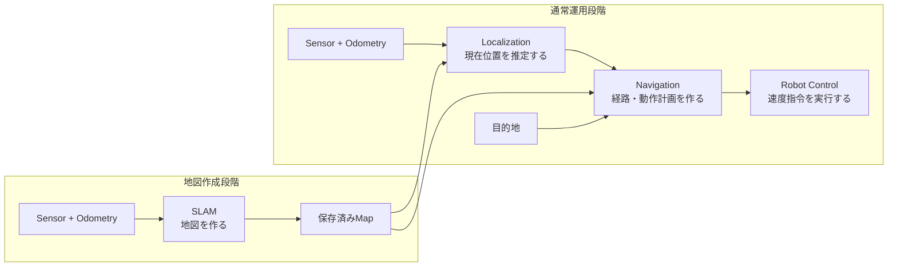

典型的には、最初にSLAMを起動して地図を保存する。通常運用ではSLAMを停止し、LocalizationとNavigationを同時に起動する。Navigationが出した速度指令は、車輪、脚、あるいは全身制御を担当するRobot Controlが実行する。したがって、アプリケーション全体は単一の「SLAM機能」ではなく、複数の機能をTopicとTFで接続した構成になる。

> **最初に決めること**：今行いたいのが「地図作成」「保存済み地図での自己位置推定」「目的地への自律移動」のどれかを明確にする。目的が違えば、起動するノードと必要な入力も変わる。

---

## 0。最初に結論

### 0.1 SLAMだけではロボットは自律移動しない

SLAMの主な役割は、次の2つである。

1. センサーを動かしながら地図を作る
2. 作成中の地図に対するセンサーまたはロボットの位置を推定する

一方、Nav2の役割は、地図と現在位置を受け取り、目的地までの経路と速度指令を生成することである。

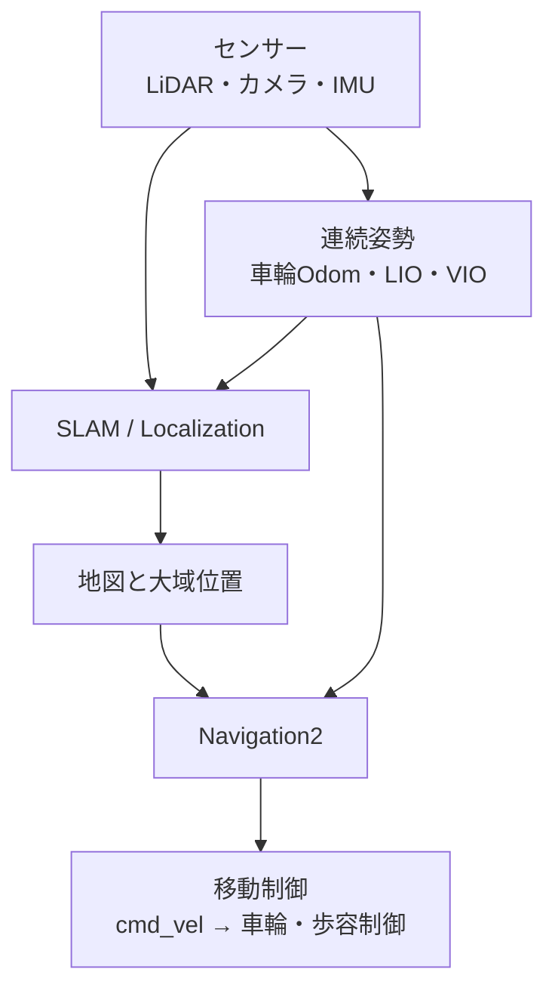

SLAMとNav2は別システムであり、両者をつなぐ共通インタフェースが、ROSメッセージとTFである。

### 0.2 車輪オドメトリは必須ではないが、連続的なローカル姿勢は必要

SLAMによって必要な入力は異なる。

- `slam_toolbox`では、通常、2D LiDARと`odom -> base_link`が必要である。
- Cartographer 2Dでは、オドメトリとIMUを使わず、LiDARのスキャンマッチングだけで動作させる構成も可能である。
- GLIM、FAST-LIO2、LIO-SAMなどは、LiDARとIMUからLiDAR-Inertial Odometry（LIO）を内部で計算できるため、車輪オドメトリは不要である。
- Visual SLAMは、連続画像からVisual Odometry（VO）を計算できる。カメラとIMUを組み合わせる場合はVisual-Inertial Odometry（VIO）となる。

ただし、Nav2を動かす段階では、最終的に連続して変化する`odom -> base_link`相当の姿勢が必要になる。車輪オドメトリがなくても、LIOやVIOがその役割を担当すればよい。

### 0.3 IMU単独は、通常、位置オドメトリの代わりにならない

「IMUベースでオドメトリ不要」という言い方は、正確には次の意味である。

> 車輪や脚から計算するオドメトリは不要だが、LiDAR＋IMUまたはカメラ＋IMUから、SLAM側がオドメトリを生成する。

IMUの加速度を2回積分して位置を求めるだけでは、わずかなバイアスや姿勢誤差が急速に蓄積する。そのため、IMU単独による長時間の位置推定は現実的ではない。

### 0.4 人がセンサーを持って地図を作ることは可能

次の構成では、センサーをロボットに載せず、人が持って歩くだけで地図と軌跡を作れる。

- Livox MID-360などの3D LiDAR＋IMUをGLIMやLIO系に入力する
- ステレオカメラまたはRGB-DカメラをRTAB-Mapに入力する
- ステレオカメラ＋IMUをVIO/VSLAMに入力する

このとき、車輪エンコーダ、`/cmd_vel`、Nav2は不要である。必要なのは、センサー時刻、LiDARとIMUまたはカメラとIMUの外部キャリブレーション、正しいデータ形式である。

ただし、作った地図を後でロボットに使わせるには、地図形式に対応する自己位置推定方法と、Nav2が利用できる2D地図またはコストマップを別途用意する必要がある。

---

## 1。SLAMとは何か

SLAMはSimultaneous Localization and Mappingの略であり、日本語では「自己位置推定と地図作成の同時実行」を意味する。

未知の環境では、次の循環問題が発生する。

- 地図を作るには、センサーを観測した位置が必要
- 現在位置を知るには、照合対象となる地図が必要

SLAMは、連続するセンサーデータを照合しながら暫定的な移動量を推定し、地図を更新する。過去に通った場所を再発見した場合は、ループ閉じ込みによって蓄積誤差を修正する。

### 1.1 SLAM内部を接続の観点から分解する

SLAMシステムは、おおむね次の機能に分けて理解できる。

| 機能 | 役割 | 代表例 |
|---|---|---|
| センサードライバ | 実機データをROSメッセージにする | LiDAR driver、camera driver |
| 前処理 | 点群補正、同期、ダウンサンプリングなど | Deskew、画像Rectify |
| ローカルオドメトリ | 直前からの連続移動を推定する | Wheel Odom、VO、VIO、LO、LIO |
| ローカルマッピング | 周辺の観測を小さな地図へ登録する | Submap、local map |
| ループ検出 | 過去に通った場所を見つける | Place recognition |
| 大域最適化 | 軌跡全体のずれを修正する | Pose graph optimization |
| 地図表現 | 結果を保存・利用する | OccupancyGrid、点群、特徴地図、DB |

重要なのは、**オドメトリとSLAMは同じものではない**ことである。

- KISS-ICPやFAST-LIO2は、高品質な連続姿勢を生成する「オドメトリ前段」として有用である。
- しかし、ループ閉じ込みや大域最適化を持たない構成では、長距離を一周しても始点と終点のずれが自動で完全には閉じない。
- GLIM、LIO-SAM、RTAB-Map、Cartographer、SLAM Toolboxなどは、大域地図やループ閉じ込みまで扱える。

### 1.2 Mapping、Localization、Navigationの違い

| 処理 | 地図 | 現在位置 | 速度指令 |
|---|---|---|---|
| Mapping / SLAM | 作る・更新する | 推定する | 原則として作らない |
| Localization | 既存地図を使う | 推定する | 作らない |
| Navigation | 既存地図を使う | TFから受け取る | 作る |

地図作成が終わった後は、通常、SLAMを停止してLocalizationモードへ移る。

- 2D OccupancyGridなら、AMCLまたはSLAM ToolboxのLocalizationモード
- RTAB-MapのDBなら、RTAB-MapのLocalizationモード
- Visual SLAMの特徴地図なら、そのライブラリ専用の再ローカライズ
- 3D点群地図なら、点群地図対応の3D Localization

「地図ファイルだけあれば、どの自己位置推定器でも使える」とは限らない。

---

## 2。ROS 2で最も重要なTFの理解 {#2ros-2で最も重要なtfの理解 .odometry-chapter}

<div id="odometry-guide"></div>

「地図上の自己位置が分かるのに、なぜオドメトリ（Odometry）も必要なのか」を、配信担当、時間、ナビゲーションでの使い道の順に理解する章である。まず、**`odom`を挟んでも、`map`上の自己位置は補正でジャンプし得る。連続性を保つのは`odom`上の位置・姿勢である**、という点を押さえる。

読み進める順序：

1. [TFの各辺は誰が出すのか](#odom-publishers)
2. [オドメトリはいつからいつまでの移動なのか](#odom-time-origin)
3. [地図上の姿勢とオドメトリをどう結び付けるのか](#odom-composition)
4. [計測・計算・Publish・制御の時系列](#odom-timeline)
5. [Nav2のどこで必要になるのか](#odom-nav2-consumers)
6. [滑りで移動を見逃したらどうなるのか](#odom-slip)

以降の数値例は、説明のため回転のない直線運動を仮定する。実機の位置・姿勢は並進と回転を組み合わせて扱う。Nav2の標準的なTF構造は次のとおりである。

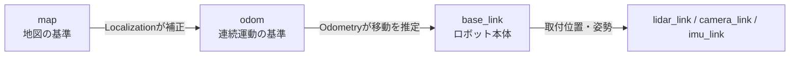

TFで`map -> odom`と書く場合、`map`が親フレーム、`odom`が子フレームである。これは、`map`座標系から見た`odom`座標系の位置・姿勢を表す。

TFは座標系そのものを単独で送る仕組みではなく、**親と子の関係を時刻付きで送る仕組み**である。「誰が`odom`を出すか」という疑問は、`map -> odom`と`odom -> base_link`のどちらを指すのかに分けると解ける。

### 2.1 各フレームの役割

| 座標系 | 意味 | 性質 |
|---|---|---|
| `map` | 保存地図や目的地の基準 | この基準での自己位置は、地図照合やループ閉じ込みで急に訂正されることがある |
| `odom` | 地図による訂正と分離した、連続運動の基準 | この基準での自己位置は連続するように設計するが、長時間では誤差が蓄積する |
| `base_link` | ロボット本体に固定した基準 | ロボットと一緒に動く |
| センサーフレーム | センサー計測値の基準 | 本体との取付位置・姿勢をURDFなどで定義する |

**自分相対の座標系は`base_link`であり、`odom`ではない。** `odom`原点は通常、初期化後は固定して扱い、その中をロボットが動く。ローリング型のLocal Costmapは表示・保持範囲がロボットに追従するが、`odom`原点自体を毎回動かすわけではない。

### 2.2 誰が、どの周期でTFを出すのか {#odom-publishers}

次は車輪＋IMUを融合する構成の例である。周期は説明用で、固定の必須値や、すべての製品の初期値ではない。

| 担当ノード | 出力 | 更新・配信の例 |
|---|---|---|
| 車輪ドライバ／コントローラ | `/wheel/odom`：車輪によるOdometry | エンコーダ計測に基づき50 Hz |
| IMUドライバ | `/imu/data`：角速度・加速度など | センサー設定により100 Hz |
| `robot_localization`の`ekf_node` | `/odometry/filtered`と`odom -> base_link` | `frequency: 50.0`なら出力目標50 Hz |
| AMCLまたは3D Localizer | 地図上の姿勢トピックと`map -> odom` | 主にスキャン入力・採用条件によって推定を更新。TF再配信は実装・設定による |
| `robot_state_publisher`など | `base_link -> sensor` | 固定取付なら`/tf_static`。可動部なら関節状態に応じた動的TF |

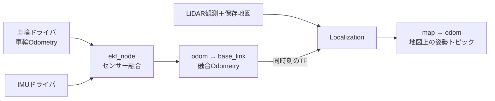

この構成では車輪側の`odom -> base_link`配信を無効にし、EKFだけがその辺を出す。EKFを使わず車輪ドライバが直接出す構成や、LIO・VIO・脚の状態推定器が出す構成でもよい。**同じTFの辺の配信担当は1系統に決める。** Nav2が地図補正やオドメトリを自動生成するわけではない。

「新しい推定を計算した回数」と「保持中の値を再配信した回数」は異なる。例えば、AMCLではスキャンを受信しても移動量・旋回量の条件などで推定更新を省く場合がある。TopicのHzだけで新しい地図照合の成功頻度を判断しない。

### 2.3 オドメトリはいつからいつまでの移動なのか {#odom-time-origin}

オドメトリは、センサーから求めた移動量を積み重ねるなどして、連続した位置・姿勢を推定する。通常は起動・初期化した時刻を`t0`として、そのときに定めた`odom`座標で現在の姿勢を表す。初期値をゼロとした直線運動なら、次のようになる。

```text
時刻                 t0         t1         t2         t3
前回からの移動量      ―       +0.02 m    +0.02 m    +0.02 m
odom上の位置         0 m       0.02 m     0.04 m     0.06 m
```

`t3`で配信する`odom -> base_link`の位置は`0.06 m`であり、今回の変位`0.02 m`ではない。往復した場合は原点に戻り得るので、これは累積走行距離でもない。**LiDAR自己位置推定の結果が届くたびに、積算値や原点をゼロに戻すことはしない。**

「局所的」とは、短い区間の相対移動を扱うのに向いているという意味であり、「直近1秒分だけを保持する」という意味ではない。区間の変位が欲しいときは、2時刻の姿勢から求める。直線なら`O(t2) - O(t1)`、回転を含むなら`inverse(O(t1)) × O(t2)`である。再起動や明示的なリセットは別の事象で、既存の局所地図との整合性を取り直す必要がある。

また、`odom`というフレーム名と、`/odom`というTopic名は別物である。

| 出力 | 含まれる情報 | 使い方 |
|---|---|---|
| TF：`odom -> base_link` | 時刻付きの位置・姿勢 | センサー、経路、ロボット姿勢を共通座標へ変換する |
| `nav_msgs/msg/Odometry.pose` | `header.frame_id`基準の位置・姿勢と共分散 | フィルタへの入力、記録など |
| `nav_msgs/msg/Odometry.twist` | `child_frame_id`基準の並進・角速度と共分散 | Nav2の現在速度など |

通常は`header.frame_id: odom`、`child_frame_id: base_link`を使う。TopicをPublishしただけではTFは自動で生成されない。融合後のTopicが`/odometry/filtered`なら、Nav2の`odom_topic`もその出力に合わせる。

### 2.4 自己位置推定は何を出すのか。「つながるように計算」とは {#odom-composition}

LiDARの地図照合が推定するのは、観測時刻における地図上のロボット位置・姿勢である。平面なら主に`x, y, yaw`、3Dなら並進3成分と回転3成分を扱う。推定器は、姿勢トピックとしてその結果と共分散を出すとともに、Nav2向けTFとして`map -> odom`を出す構成にできる。

同じ時刻の推定が次の値だったとする。

```text
LiDAR地図照合：map上のロボット位置 M = 104.00 m
オドメトリ：  odom上のロボット位置 O =   5.00 m

M = C + O を満たす補正Cを求める
C = 104.00 - 5.00 = 99.00 m

map ── +99.00 m ──→ odom ── +5.00 m ──→ base_link
              合成すると map上で104.00 m
```

`C`は、`map`から見た`odom`原点の位置である。初期の原点・向きの違いも含むので、すべてが蓄積誤差というわけではない。**「つながる」とは、TFを合成したロボット姿勢を、同時刻の地図照合結果と一致させること。ジャンプを打ち消して滑らかにつなぐという意味ではない。**

回転を含む一般の計算は、次の座標変換行列で表せる。`T_A_B`は「Aから見たBの姿勢」、つまりBで表した点をAへ変換する行列とする。

```text
O(ts) = T_odom_base(ts)             # 計測時刻tsのオドメトリ
M(ts) = T_map_base_localization(ts) # 計測時刻tsの地図照合結果
C     = M(ts) × inverse(O(ts))      # map → odomとして配信

T_map_base(ts) = C × O(ts) = M(ts)
```

ロボット姿勢を`map -> base_link`として直接出すモードもあるが、標準的なNav2接続では上記の分担を使う。同じ`base_link`に`map`と`odom`の2つの親を与えない。

### 2.5 計測からPublish、Nav2制御までの時系列 {#odom-timeline}

**計測時刻とPublish時刻を分けて考える。** 点群のタイムスタンプが10.00秒で、地図照合が10.06秒に終わっても、その結果は原則として10.00秒の姿勢である。実際の点群は走査時間を持つため、ドライバのタイムスタンプ規約とDeskewの基準時刻もそろえる。

次の数値例では、オドメトリ50 Hz、LiDAR10 Hz、地図照合60 ms、Nav2制御20 Hzを仮定する。ロボットは毎秒1 mで直進し、各ループは独立して動く。

| 実際の時刻 | オドメトリの処理 | LiDAR自己位置推定の処理 | Nav2の処理例 |
|---|---|---|---|
| 10.00秒 | `O(10.00)=5.00 m`を配信 | 10.00秒の点群を受け取り照合開始 | その時点で利用可能なTF・速度・経路で制御 |
| 10.02秒 | `O(10.02)=5.02 m`を配信 | 計算中 | 次の制御周期待ち |
| 10.04秒 | `O(10.04)=5.04 m`を配信 | 計算中 | 次の制御周期待ち |
| 10.05秒 | 独立して更新を継続 | 計算中 | 以前の補正と利用可能なオドメトリで制御 |
| 10.06秒 | `O(10.06)=5.06 m`を配信 | `M(10.00)=104.00 m`と判明。同時刻の`O(10.00)`で補正を計算し出力 | 次の制御周期で更新されたTFを利用 |
| 10.08秒 | `O(10.08)=5.08 m`を配信 | 次の点群待ち | 次の制御周期待ち |
| 10.10秒 | `O(10.10)=5.10 m`を配信 | 次の点群を受け取り照合開始 | TFが利用可能な時刻で姿勢を取得し制御 |

10.06秒に計算が終わったとき、自己位置推定ノードはTFの履歴から10.00秒のオドメトリを取得する。必要な時刻を挟むTFサンプルがあれば補間できる。計算は`104.00 - 5.00 = 99.00 m`であり、最新の5.06 mを引いてはいけない。時刻を混ぜると、計算中に動いた0.06 mを誤って補正へ入れてしまう。

得られた補正を保持し、その後のオドメトリを組み合わせると、理論上の10.06秒の推定位置は次になる。

```text
map位置(10.06) = 補正C + O(10.06)
               = 99.00 + 5.06 = 104.06 m

同じ計算を移動区間で表すと：
現在の推定位置 = LiDARで求めた過去の位置
               + その計測時刻から現在までのオドメトリ変位
               = 104.00 + (5.06 - 5.00)
```

**オドメトリ自体は初期化時からの累積姿勢だが、LiDAR結果を現在へ進めるために使う変位の区間は、LiDAR計測時刻から現在まで**である。回転を含む式では`M(ts) × inverse(O(ts)) × O(t)`となる。

ただし、数式が成立することと、その時刻のTFが取得できることは別である。TFは動的な辺を無期限に未来へ外挿しない。補正の再配信や有効時刻の扱いは推定ノードに依存し、取得側は履歴のある時刻、最新の共通時刻、許容遅延に従う。履歴不足・古いTF・時計ずれは、待機やTFエラーの原因になる。許容遅延を増やしても、欠けた実測値が生成されるわけではない。

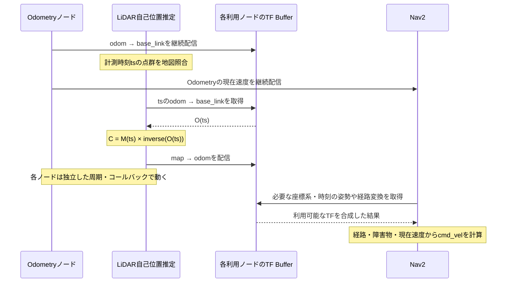

TF Bufferは中央サーバーではなく、各リスナーが受信した変換を保持する履歴である。メッセージの送信、受信、制御周期は同時ではなく、Nav2はLiDAR結果のPublishを毎回待ってから1回動く構成ではない。

### 2.6 map上の位置はジャンプしたままでよいのか {#odom-jump}

次の地図照合で位置が修正された場合も、`odom`を書き戻さず補正を変える。

| 同じ10.10秒の姿勢を評価する状態 | `map -> odom`の補正C | `odom -> base_link`の位置O | 合成したmap上の位置 |
|---|---:|---:|---:|
| 前回の補正で予測 | 99.00 m | 5.10 m | 104.10 m |
| 新しい地図照合が104.12 mと推定 | 99.02 m | 5.10 m | 104.12 m |

`map`上の位置は0.02 m変わる。大域再位置推定では、もっと大きく変わることもある。一方、`odom`上の位置は同じ5.10 mである。**2つの変換を掛けるとジャンプが相殺されるわけではない。地図上での訂正と、連続した移動履歴を別々に利用できることが目的である。**

### 2.7 最終的にNav2はどの値を使うのか {#odom-nav2-consumers}

典型的にGlobal Costmapを`map`、Local Costmapを`odom`に設定した場合、主な利用先は次のとおりである。フレームやController内部の処理はプラグイン・設定によって変わる。

| 利用先 | 参照する情報 | 必要な理由 |
|---|---|---|
| Planner / Global Costmap | TFを合成した`map -> base_link`、地図、map上の目的地 | 見えていない遠方も含め、地図上で経路を作る |
| Local Costmap | 観測時刻の`odom -> base_link -> sensor` | 過去と現在の近傍観測を同じ基準へ登録する |
| Controller | 局所地図基準のロボット姿勢、経路、障害物 | 直近の経路追従と回避を計算する |
| 経路・ゴールの座標変換 | `map -> odom`などのTF | 地図上の計画を局所制御の座標系へそろえる |
| Controllerの現在速度 | `odom_topic`で指定したOdometryの`twist` | 現在の運動状態を踏まえて次の速度指令を決める |

標準的なNav2接続では、Localizerの`/pcl_pose`などをそのまま現在位置として購読するのではなく、姿勢は主にTFから取得する。速度はOdometry Topicから取得し、`/cmd_vel`はNav2が計算した指令である。**推定姿勢のPublish、TFの配信、Nav2の制御は別経路・別ループ**なので、姿勢Topicが見えてもTFが欠けていればナビゲーションは成立しない。

### 2.8 なぜわざわざodomを挟むのか：壁と目的地の例 {#odom-local-map}

ロボットが静止し、前方2 mに壁があるとする。次の例では`odom`上のロボット位置が5 m、壁が7 mで、最初の地図補正は100 mとする。

```text
odom基準：ロボット x=5   ── 2 m ── 壁 x=7
map基準： ロボット x=105 ── 2 m ── 壁 x=107
```

地図照合で「ロボットはmap上で104 m」と訂正されても、実際のロボットと壁は動いていない。`map -> odom`は100 mから99 mになる。

| 観測を保持する基準 | 補正前に記録した壁 | 補正後の新しい壁の観測 | 結果 |
|---|---:|---:|---|
| `map`で過去の観測をそのまま保持 | 107 m | 106 m | 同じ壁の過去と現在がずれる。消去や再配置が必要 |
| `odom`で保持 | 7 m | 7 m | 地図補正だけでは、近傍観測の整合性が崩れない |

単発の観測を自分相対で見るだけならセンサーフレームや`base_link`でも表せる。しかし、ロボットが動きながら複数回の観測を積み重ねるには、各時刻の移動を考慮した共通基準が必要になる。そこで`odom`を使う。静的地図レイヤーやmap由来の情報は補正の影響を受け得るが、**odomで保持した局所観測を、地図上の訂正だけで壊さずに済む**。

遠方の目的地・経路は`map`基準なので、補正を無視するわけではない。地図上の経路点が110 mなら、局所制御には次のように変換して渡る。

| 状態 | map上の経路点 | 補正C | odomへ変換した経路点 | odom上のロボット | 経路点までの距離 |
|---|---:|---:|---:|---:|---:|
| 補正前 | 110 m | 100 m | 10 m | 5 m | 5 m |
| 補正後 | 110 m | 99 m | 11 m | 5 m | 6 m |

自分と壁の関係は保ち、「目的地は思っていたより1 m遠かった」という訂正を計画へ反映できる。Local Costmapは近傍の観測を更新しながら使い、オドメトリが大きくドリフトするほど長く古い観測を保持しない。

`map -> base_link`だけで自律移動するシステムも設計できる。ただし、連続した局所観測の管理と大域訂正を自分で扱う必要がある。標準Nav2では、この分離を`map -> odom -> base_link`で表す。

### 2.9 速度がオドメトリ由来なら、極端な動きを防げるのか {#odom-velocity}

静止中、地図上の位置だけが0.1秒の間に1 m訂正された場合、map位置の差分から速度を作ると「10 m/sで移動した」と誤認し得る。オドメトリの現在速度を利用すれば、この地図訂正を実際の加減速と取り違えにくい。TF自体には速度値は入っていない。

ただし、**現在速度と、次に出す速度指令は別物**である。経路をodomへ変換した位置も補正で変わるので、Controllerが急に旋回しようとする可能性は残る。odomを使うだけで指令の滑らかさが保証されるわけではなく、Controllerの速度・加減速制限やVelocity Smootherなどを合わせて設定する。地図補正を見えなくすることが目的ではない。

### 2.10 車輪が回らず機体が滑ったらどうなるのか {#odom-slip}

「動かしていない」は「物理的に移動していない」とは限らない。車輪が回らないまま、機体が前方の壁へ0.5 m滑ったとする。

| 情報 | 滑る前 | 滑った後 |
|---|---|---|
| 実際の壁までの距離 | 2 m | 1.5 m |
| 車輪だけのodom位置 | 5 m | 5 m：滑りを見逃す |
| LiDAR観測からodomへ登録した壁 | 7 m | 6.5 m：過去の観測とずれる |
| LiDARの地図照合 | 地図上の位置を推定 | 照合に成功すれば、実際の機体移動を検出する |

地図照合に成功すれば`map -> odom`を変え、地図上の位置を修正できる。しかし、**それだけでodomが見逃した移動や、odomで保持した過去の壁の位置が直るわけではない。** 新しい障害物観測、空き領域のレイトレース、レイヤーに応じた減衰・クリアで局所地図を更新する。見え方や設定次第で古い障害物が残ることがあり、補正すれば必ず即座に回復するとは限らない。

滑りを局所移動として追跡するには、車輪以外から機体の移動を測る。

| 計測源 | 補えること・限界 |
|---|---|
| 車輪・脚の運動学 | 車輪の滑り、足の接地ずれなどで移動と計算が一致しなくなる |
| IMU | 加速度・回転の変化を捉えるが、等速移動を加速度だけから判別できない。バイアスがあり、単独の位置積分はドリフトする |
| LiDAR Odometry / LIO | 周囲の形状変化で機体移動を推定する。特徴の乏しい廊下、遮蔽などでは不確かになる |
| Visual Odometry / VIO | 画像変化で機体移動を推定する。暗所、模様不足、ブレなどでは不確かになる |

車輪・脚とIMU、LIO、VIOなどを適切に選択・融合して`odom -> base_link`へ反映する。EKFを置くだけで、どのセンサーにも観測できない滑りが分かるわけではない。車輪位置とその微分速度など相関の強い情報を、独立な観測として重複投入しない。**連続性は正確さの保証ではなく、odomというフレームを設けること自体は滑り対策ではない。**

### 2.11 lidar_localization_ros2での対応と確認方法 {#odom-lidar-localization}

ここでは[rsasaki0109/lidar_localization_ros2](https://github.com/rsasaki0109/lidar_localization_ros2)を例にする。既存の点群地図へ現在の点群を照合するLocalizationであり、地図を新たに作るSLAMとは区別する。2026-10-13に参照した公開実装の構成を示すが、利用中のコミットとLaunchの上書き設定を確認すること。

| 設定・出力 | 意味 |
|---|---|
| `enable_map_odom_tf: false` | Localizerが`map -> base_link`を直接出すモード |
| `enable_map_odom_tf: true` | Localizerが`map -> odom`を出す。別ノードの`odom -> base_link`が必要 |
| `use_odom: true` | Odometry入力を予測に使う設定。外部のodom TFを自動生成する設定ではない |
| `/pcl_pose`（既定名） | 地図上の推定姿勢と共分散。Launchで別Topicへリマップされる場合がある |

通常の姿勢出力経路では、`publishCurrentPose()`が姿勢Topicを配信し、`publishMapToOdomTransform()`が同じ`stamp`の`odom -> base_link`を取得して補正TFを配信する。TF取得に失敗すると、姿勢Topicが出ても対応する補正TFは出ない。タイマーや予測・再配信の機能もあるため、姿勢TopicのHzは必ずしも新しい地図照合のHzではない。

```bash
# 使用中のノード名・入出力を先に確認する
ros2 node list
ros2 topic list -t

# 融合Odometryを使う場合は /odom を実際のTopic名へ変更する
ros2 topic info /odom --verbose
ros2 topic hz /odom
ros2 topic echo /odom --once

# 各変換が存在し、期待する動きをするか確認する
ros2 run tf2_ros tf2_echo odom base_link
ros2 run tf2_ros tf2_echo map odom
ros2 run tf2_ros tf2_echo map base_link

# Nav2が参照する速度Topicと制御周期
ros2 param get /controller_server odom_topic
ros2 param get /controller_server controller_frequency

# Localizerの既定Topic名。リマップしている場合は置き換える
ros2 topic hz /pcl_pose
ros2 topic echo /alignment_status --once
```

各監視コマンドは別端末で実行するか、終了してから次へ進む。`tf2_echo`の表示周期や`ros2 topic hz /tf`だけでは、個別のTFの配信周期は分からない。必要なら`/tf`を記録して親子フレームごとのタイムスタンプを確認し、`ros2 node info`や各ノードの設定で所有者を照合する。実機未接続のこの教材では、上の周期例を実測値として扱わない。

### 2.12 理解を確認する問いと参考資料 {#odom-review}

| 問い | 答え |
|---|---|
| odomはロボットに固定された座標か | いいえ。それは`base_link`。odomは連続運動を記録する基準 |
| 自己位置推定のたびにodomをリセットするか | しない。地図とのずれは`map -> odom`で扱う |
| odomを挟めばmap上のジャンプも消えるか | 消えない。連続した局所移動と地図上の訂正を分けて利用できる |
| 60 ms前のLiDAR位置から補正を作る際、どのodomを使うか | LiDARと同じ計測時刻のodom。最新値と混ぜない |
| odomは速度のためだけに必要か | いいえ。局所観測の蓄積、移動量、経路の座標変換にも使う |
| odomが滑らかなら滑りを正しく測れているか | 限らない。実際の機体移動を観測できるセンサーが必要 |

本章の導入は、赤井直紀氏の[オドメトリフレーム（/odom）とは何か](https://qiita.com/NaokiAkai/items/08deb338956c8da83aa9)を参考に、局所観測を連続して保持する理由から整理した。周期と距離の数値例は本教材の説明用である。

- [REP-105：フレームの意味と配信責任](https://www.ros.org/reps/rep-0105.html)
- [Nav2：Transform設定](https://docs.nav2.org/setup_guides/transformation/setup_transforms.html)
- [Nav2：Odometry設定](https://docs.nav2.org/setup_guides/odom/setup_odom.html)
- [robot_localization：センサー融合の設定](https://docs.ros.org/en/melodic/api/robot_localization/html/configuring_robot_localization.html)
- [lidar_localization_ros2：TFモード](https://github.com/rsasaki0109/lidar_localization_ros2/blob/main/docs/frame_contract.md)
- [lidar_localization_ros2：姿勢・TF配信の実装](https://github.com/rsasaki0109/lidar_localization_ros2/blob/main/src/component_pose_publisher.cpp)
- [Nav2 Humble：Controller Serverの実装](https://github.com/ros-navigation/navigation2/blob/humble/nav2_controller/src/controller_server.cpp)

MID-360での接続手順は、[11. Nav2ナビゲーション](../slam-localization-api/lidar_localization_ros2/11_navigation.html)も参照する。単一ファイル版だけをコピーした場合、この別教材へのリンクにはリポジトリ一式が必要になる。

---

## 3。SLAMの種類

### 3.1 2D LiDAR SLAM

#### 概要

床がほぼ平面であると仮定し、水平面の`LaserScan`を2D地図へ登録する。地図は通常、`nav_msgs/msg/OccupancyGrid`として表現される。

#### 適した用途

- 屋内の車輪移動ロボット
- 同一階の巡回
- Nav2を最短で成立させたい場合
- 計算資源を抑えたい場合

#### 主な入力

- `sensor_msgs/msg/LaserScan`
- `odom -> base_link`
- `base_link -> laser_frame`
- ライブラリによってはIMUまたは`nav_msgs/msg/Odometry`

#### 長所

- Nav2の2Dコストマップへ直接接続しやすい
- 地図が軽い
- 成熟したROS 2パッケージがある
- 平坦な屋内では調整項目が比較的少ない

#### 制約

- 階段、上下階、立体交差を単一の2D地図で正しく扱いにくい
- LiDAR高さより上または下の障害物を地図へ表しにくい
- ガラス、鏡、長い特徴のない廊下で不安定になる場合がある

#### 代表ライブラリ

##### SLAM Toolbox

- ROS 2で2D SLAMを始める際の第一候補
- `LaserScan`と`odom -> base_link`を利用
- `map -> odom`と`OccupancyGrid`をPublish
- 地図だけでなくPose Graphをシリアライズでき、後から地図更新やLocalizationを継続可能
- Nav2との接続が容易

##### Cartographer 2D

- 2Dと3Dの両方に対応
- 2Dでは、オドメトリとIMUはオプション
- オドメトリなしの場合は、LiDARスキャンマッチングの探索量と計算負荷が増える
- 複数のLaserScanやPointCloud2を入力可能
- 高機能だが、Lua設定とセンサー時刻の調整が比較的難しい

##### Hector SLAM

- 歴史的に、車輪オドメトリなしで高周期LiDARから2D SLAMを行う用途で使われてきた
- ROS 2で新規構築する場合は、パッケージ保守状況と対象ディストリビューションを確認する
- 現在の一般的なROS 2/Nav2学習では、まずSLAM ToolboxまたはCartographerを検討する方が接続を理解しやすい

---

### 3.2 3D LiDAR・3D点群ベースSLAM

#### 概要

3D LiDARやRGB-Dカメラから得た`PointCloud2`を3次元空間へ登録する。6自由度の位置・姿勢を推定できるため、センサーが傾く四足歩行ロボット、人が持つセンサー、坂、段差、複数階の記録に向いている。

#### 主な方式

| 方式 | 入力 | 車輪Odom | 説明 |
|---|---|---:|---|
| LiDAR Odometry（LO） | 3D LiDAR | 不要 | 連続点群を照合して移動量を求める |
| LiDAR-Inertial Odometry（LIO） | 3D LiDAR＋IMU | 不要 | IMUで高速運動と姿勢を補い、点群でドリフトを抑える |
| 3D Graph SLAM | LO/LIO＋点群 | 不要または任意 | ループ閉じ込みと全体最適化を行う |

#### 代表ライブラリ

##### GLIM

- ROS 2対応の3D Range-Inertial Localization and Mapping
- Livox Avia、MID-360、Velodyne、Ouster、RGB-Dなどに対応
- 標準構成はLiDAR＋IMU
- LiDARのみのオドメトリ構成も用意されている
- CPU構成とGPU構成がある
- ループ閉じ込み、大域最適化、マルチセッション統合、手動修正、PLYエクスポートが可能
- Ubuntu 22.04 / 24.04でテストされており、ROS 2 Humble環境にも適する
- Livox MID-360を人が持って地図作成する用途の有力候補

##### LIO-SAM

- LiDAR＋IMUを密結合し、Factor Graphで軌跡を最適化
- GPSを追加する構成も可能
- IMU事前積分とLiDAR Odometryを利用
- 点ごとの時刻情報が重要で、Deskewできる点群形式が必要
- 公式リポジトリにROS 2ブランチがある
- センサー軸、IMU姿勢、LiDAR-IMU外部パラメータの調整難度は高め

##### FAST-LIO2

- LiDAR＋IMUから高速なLIOを生成
- Livox系の非反復走査LiDARと相性がよい
- 車輪オドメトリは不要
- 高速なローカルオドメトリとインクリメンタル点群地図を得る用途に強い
- 標準のFAST-LIO2単体は、ループ閉じ込みを中心とした完全な大域Graph SLAMではない
- 長距離で地図全体を閉じたい場合は、ループ閉じ込みバックエンドを追加するか、GLIMなどを選ぶ
- 元リポジトリはROS 1中心なので、ROS 2では利用する移植版の保守状態を確認する

##### KISS-ICP

- `PointCloud2`だけでLiDAR Odometryを生成できる
- 公式ROS 2 Wrapperがある
- IMUや車輪オドメトリなしで試しやすい
- 主目的はオドメトリであり、ループ閉じ込みを含む地図全体の大域最適化は別途必要
- 「オドメトリ前段」と「SLAM後段」の違いを学ぶ教材として分かりやすい

##### Cartographer 3D

- 3D LiDARとIMUによる3D SLAM
- 3DモードではIMUが必須
- 外部オドメトリは任意
- 複数の点群入力に対応
- ROS 2 Humbleパッケージは存在するが、現在の新規3D LiDAR構成ではGLIMなども比較対象にする

#### 3D地図とNav2をつなぐ際の注意

3D SLAMを使ったからといって、Nav2が自動的に3D経路計画を行うわけではない。標準的なNav2は2D Costmapを中心に動作する。

したがって、次のいずれかが必要になる。

1. 3D点群を床面方向へ投影し、2D OccupancyGridを作る
2. 3D地図上でLocalizationしながら、Nav2用の2D地図を別に持つ
3. 3Dセンサーの現在点群を、Nav2のVoxel LayerまたはObstacle Layerへ入力する
4. 階段や複数階は、階ごとのNav2地図と上位のフロア移動管理を組み合わせる

3D SLAMは「3D地図と6DoF姿勢推定」を解決するが、「脚をどこに置くか」「階段をどう登るか」まで自動で解決するものではない。

---

### 3.3 Visual SLAM

#### 概要

カメラ画像から特徴点や画像の明暗情報を追跡し、カメラ姿勢と地図を推定する。

#### カメラ構成による違い

| 構成 | 距離スケール | 特徴 |
|---|---|---|
| 単眼カメラ | 単眼画像だけでは絶対スケールが不定 | 安価だが、初期化とスケール処理が難しい |
| 単眼＋IMU | IMU初期化後にメートルスケールを得られる | キャリブレーションと同期が重要 |
| ステレオカメラ | 左右カメラ間距離からスケールを得る | 屋内移動や手持ちに向く |
| RGB-Dカメラ | Depthから距離を得る | 屋内で導入しやすいが、距離・日光条件に制約 |
| ステレオ＋IMU | ステレオと慣性を統合 | 高速運動や一時的な画像特徴不足に比較的強い |

#### 代表ライブラリ

##### RTAB-Map

- ROS 2 Humble、Jazzy、Rolling向けパッケージがある
- RGB-D、ステレオ、3D LiDARに対応
- `rgbd_odometry`、`stereo_odometry`、`icp_odometry`などを構成できる
- 外部の車輪オドメトリを入力することも、RTAB-Map側でVO/ICP Odomを生成することも可能
- ループ閉じ込み、DB保存、点群地図、2D OccupancyGrid、Localizationモードを持つ
- Visual SLAMからNav2まで一つのROS 2構成で学びやすい

##### ORB-SLAM3

- 単眼、ステレオ、RGB-D、単眼＋IMU、ステレオ＋IMUに対応
- Visual、Visual-Inertial、Multi-Map SLAMを扱う
- 疎な特徴点地図とカメラ軌跡を生成する
- 公式リポジトリのROS例はROS 1 Melodic基準であり、ROS 2では第三者Wrapperの選定が必要
- GPLv3ライセンスのため、商用・閉源システムへの組込みではライセンス確認が必要
- SLAM研究やアルゴリズム比較には有力だが、Nav2へ直接つなぐにはTF、Odometry、2D地図生成のAdapterが必要

##### Isaac ROS Visual SLAM

- NVIDIA GPUを使う高性能なROS 2 VSLAM
- ステレオ、Visual-Inertial、RGB-D Trackingを扱う
- Navigationへ渡せるVisual Odometryを生成
- 現行の公式導入例はROS 2 Jazzy中心なので、Humble環境では対応バージョンを確認する
- 疎なVisual MapだけではNav2の障害物地図にならないため、Nvbloxなどの地図生成系との組合せを検討する

#### Visual SLAMの制約

- 白い壁や繰り返し模様など、特徴の少ない場所で追跡しにくい
- 暗所、逆光、露出変化に影響される
- 速く振るとMotion Blurが発生する
- Rolling Shutterカメラでは高速運動時に画像がゆがむ
- レンズ内部パラメータとカメラ間・カメラIMU間の外部パラメータが重要
- Visual SLAMの特徴地図は、Nav2が読む2D OccupancyGridとは別物である場合が多い

---

### 3.4 複合型SLAM

実機では、一つのセンサー方式だけに限定せず、複数の推定を組み合わせることがある。

- 車輪Odom＋IMU＋Visual Odometry
- 脚運動学Odom＋IMU＋LiDAR Odometry
- LiDAR-Inertial＋GNSS
- Visual-Inertial＋LiDAR Loop Closure
- 2D LiDAR SLAM＋3D LiDAR障害物検出

`robot_localization`は、複数のOdometryやIMUをEKF/UKFで統合し、滑らかな`odom -> base_link`を生成する際に使える。ただし、どのデータのどの成分を融合するかを明示し、同じ情報を重複入力しないことが重要である。

---

## 4。代表ライブラリの比較

### 4.1 センサー・オドメトリ要件

| ライブラリ | 分類 | 主入力 | 車輪/脚Odom | IMU | 内部Odom | ループ閉じ込み |
|---|---|---|---:|---:|---:|---:|
| SLAM Toolbox | 2D SLAM | LaserScan | 通常必要 | 不要 | Scan matchingで補正 | あり |
| Cartographer 2D | 2D SLAM | LaserScan / PointCloud2 | 任意 | 任意 | あり | あり |
| Cartographer 3D | 3D SLAM | PointCloud2 | 任意 | 必須 | あり | あり |
| RTAB-Map | Visual / RGB-D / LiDAR SLAM | 画像、Depth、点群 | 外部入力または不要 | 任意 | VO/ICP Odomを構成可能 | あり |
| GLIM | 3D LiDAR/Range SLAM | PointCloud2＋IMU | 不要 | 標準では使用、LiDAR-only可 | LIO/LO | あり |
| LIO-SAM | 3D LIO-SLAM | 3D LiDAR＋IMU | 不要 | 必須 | LIO | あり |
| FAST-LIO2 | 3D LIO | 3D LiDAR＋IMU | 不要 | 必須 | LIO | 標準単体ではなし |
| KISS-ICP | 3D LiDAR Odom | PointCloud2 | 不要 | 不要 | LO | なし |
| ORB-SLAM3 | Visual/VIO SLAM | Mono/Stereo/RGB-D＋任意IMU | 不要 | モードによる | VO/VIO | あり |
| Isaac ROS VSLAM | Visual/VIO SLAM | Stereo/RGB-D＋任意IMU | 不要 | モードによる | VO/VIO | あり |

### 4.2 地図出力とNav2へのつなぎやすさ

| ライブラリ | 主な地図・保存形式 | Nav2への接続 |
|---|---|---|
| SLAM Toolbox | OccupancyGrid、Pose Graph | 非常に容易 |
| Cartographer 2D | Submap、OccupancyGrid、State | 容易 |
| Cartographer 3D | 3D Submap、State、出力Assets | 2D投影または別地図が必要 |
| RTAB-Map | DB、点群、OccupancyGrid | 比較的容易 |
| GLIM | Mapping Dump、軌跡、PLY点群 | TF Adapterと2D地図生成を設計 |
| LIO-SAM | 点群地図、軌跡 | TF Adapterと2D地図生成を設計 |
| FAST-LIO2 | LIO軌跡、PCD | 大域Localization/Loop Closureを追加 |
| KISS-ICP | Odometry、局所/蓄積点群 | SLAM後段またはLocalizationを追加 |
| ORB-SLAM3 | 疎な特徴地図、軌跡 | ROS 2 Adapterと障害物地図が必要 |
| Isaac ROS VSLAM | Visual Map、Odometry | Nvblox等の地図系と組み合わせる |

### 4.3 用途別の選び方

| 目的 | 最初の候補 | 理由 |
|---|---|---|
| 平坦な屋内でNav2を学ぶ | SLAM Toolbox＋2D LiDAR | ROS 2/Nav2との境界が分かりやすい |
| 2D LiDARだけで手押し・手持ちマッピング | Cartographer 2D | Odomなし構成が可能 |
| Livox MID-360を人が持って3D地図作成 | GLIM | ROS 2、MID-360、IMU、オフライン処理に対応 |
| Livoxから高速な連続姿勢だけ欲しい | FAST-LIO2 | 高速LIO |
| IMUなしの3D LiDAR Odomをまず試す | KISS-ICP | ROS 2でPointCloud2だけから試せる |
| RGB-D/ステレオで地図とLocalization | RTAB-Map | ROS 2統合とNav2例が豊富 |
| NVIDIA GPUでVSLAM/VIO | Isaac ROS Visual SLAM | GPU最適化されたROS 2構成 |
| Visual SLAMアルゴリズムを研究 | ORB-SLAM3 | 多様なカメラ・IMUモード |

---

## 5。ROS 2上の接続インタフェース

### 5.1 よく使うトピックと型

| 用途 | 代表トピック | 型 |
|---|---|---|
| 2D LiDAR | `/scan` | `sensor_msgs/msg/LaserScan` |
| 3D LiDAR | `/points`、`/livox/lidar` | `sensor_msgs/msg/PointCloud2`または専用型 |
| IMU | `/imu/data`、`/livox/imu` | `sensor_msgs/msg/Imu` |
| カメラ画像 | `/camera/image_rect` | `sensor_msgs/msg/Image` |
| カメラ内部情報 | `/camera/camera_info` | `sensor_msgs/msg/CameraInfo` |
| オドメトリ | `/odom`、`/odometry/filtered` | `nav_msgs/msg/Odometry` |
| 2D地図 | `/map` | `nav_msgs/msg/OccupancyGrid` |
| TF | `/tf`、`/tf_static` | `tf2_msgs/msg/TFMessage` |
| Navigation目標 | `/navigate_to_pose` | `nav2_msgs/action/NavigateToPose` |
| Localization初期姿勢 | `/initialpose` | `geometry_msgs/msg/PoseWithCovarianceStamped` |
| 速度指令 | `/cmd_vel` | `geometry_msgs/msg/Twist` |

実際のトピック名はRemapできる。大切なのは名前そのものではなく、メッセージ型、時刻、`frame_id`、QoS、TFが一致していることである。

### 5.2 センサーTF

例えば、LiDARとIMUを搭載したロボットでは次のようにする。

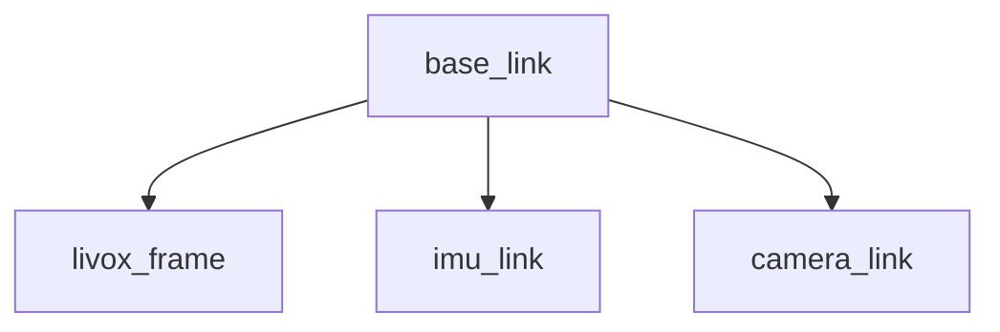

固定された取付位置は、URDFと`robot_state_publisher`で配信するのが基本である。検証だけなら`static_transform_publisher`でもよい。

誤った外部パラメータは、次の症状を起こす。

- 回転すると点群の壁が二重になる
- 前進しただけなのに高さが変わる
- 地図全体が斜めになる
- IMUを有効にした途端に軌跡が飛ぶ

### 5.3 時刻同期

SLAMでは、値そのものと同じくらい`header.stamp`が重要である。

- LiDARの各点または各スキャンの時刻
- IMUの時刻
- 左右カメラ画像の時刻
- RGBとDepthの時刻
- 別PC間のシステム時刻

3D LiDARでは、1スキャンを取得している間にもセンサーが動く。点ごとの時刻とIMUを使って動きのゆがみを補正する処理がDeskewである。点時刻が欠ける、単位が違う、LiDARとIMUにオフセットがある場合、点群が重ならない。

### 5.4 QoS

センサードライバがBest Effort、受信側がReliable固定など、QoSが非互換だとトピック名が合っていても受信できない。

確認には次を使う。

```bash
ros2 topic info /scan -v
ros2 topic info /livox/lidar -v
ros2 topic info /imu/data -v
```

### 5.5 LIO/VIOのセンサー姿勢をNav2用TFへ変換する

LIOやVIOの出力は、必ずしも最初から次の形になっているとは限らない。

```text
odom -> base_link
```

例えば、次のような独自フレームでLiDARまたはカメラ自身の姿勢を出す場合がある。

```text
camera_init -> body
world -> lidar_link
visual_odom -> camera_link
```

ロボットへ載せる場合は、Estimatorの出力フレームを確認し、次の役割を持つAdapterを用意する。

1. Estimatorが出したLiDARまたはカメラ姿勢を受け取る
2. 既知の`base_link -> sensor`を使い、ロボット本体姿勢へ変換する
3. 連続している姿勢を`odom -> base_link`としてPublishする
4. ループ閉じ込み後の大域姿勢との差から`map -> odom`を生成する
5. 必要なら`nav_msgs/msg/Odometry`もPublishする

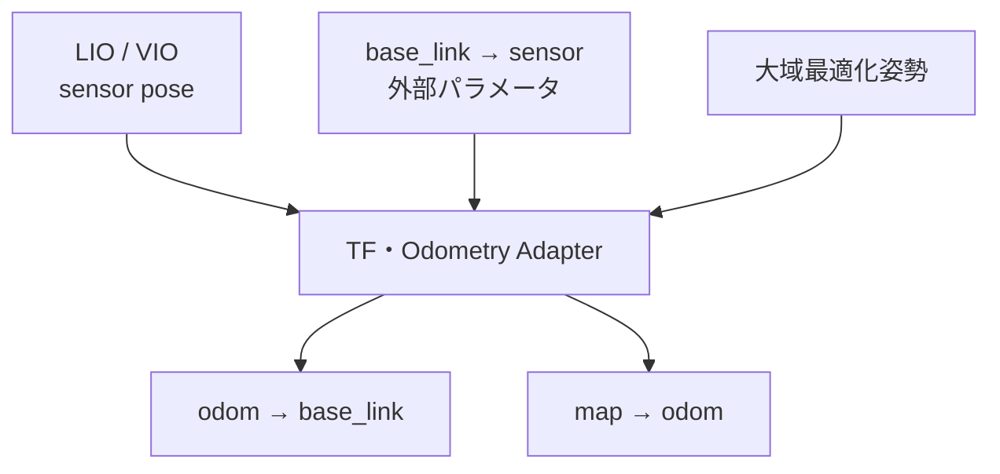

GLIMのように、ループ閉じ込み前のOdometry軌跡と、ループ閉じ込み後の大域軌跡を区別できる場合、概念上は次のように対応させる。

- ループ閉じ込み前の連続姿勢：`odom -> base_link`
- ループ閉じ込み後の大域姿勢：`map -> base_link`
- 両者の差：`map -> odom`

TF計算は時刻付きで行い、最新値だけを単純に引き算しない。3D姿勢では回転を含むため、`tf2`によるTransform合成・逆変換を使う。

四足歩行ロボットでは、LIOの6DoF姿勢を保持した`base_link`と、Nav2用の平面フレーム`base_footprint`を分ける方法がある。その場合も、TFツリーの親子関係とPublish担当を一意にする。

---

## 6。Nav2へつなぐ仕組みとコストマップ {#6nav2へつなぐ仕組み .costmap-chapter}

Nav2が必要とするものを、接続の観点で整理する。

| 入力 | 提供するシステム |
|---|---|
| 2D静的地図またはSLAM中の地図 | Map Server、SLAM |
| `map -> odom` | AMCL、SLAM、Localization |
| `odom -> base_link` | Wheel/Leg Odom、LIO、VIO、EKF |
| `base_link -> sensor` | URDF、static TF |
| 障害物センサー | LaserScan、PointCloud2、Depth |
| ロボット形状 | `footprint`または`robot_radius` |
| 速度・加速度制限 | Nav2 Controller設定 |

Nav2からロボット側へは、通常、`/cmd_vel`が出る。

### 6.1 車輪ロボット {#61-車輪ロボット}

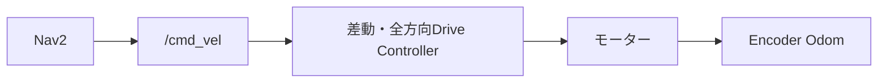

### 6.2 四足歩行・ヒューマノイド {#62-四足歩行ヒューマノイド}

四足歩行ロボットやヒューマノイドでも、Nav2から見た基本インタフェースは同じにできる。

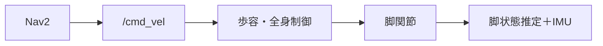

ただし、次を別途設計する必要がある。

- `cmd_vel`の速度を安全な歩容指令へ変換する
- 脚運動学とIMUから`odom -> base_link`を推定する
- 胴体が上下・傾斜しても、Nav2用に`base_footprint`を定義する
- 転倒、足場、段差、階段はNav2の通常の2D衝突回避とは別に扱う

### 6.3 Mapping中とLocalization中のTF所有者 {#63-mapping中とlocalization中のtf所有者}

| 運用状態 | `map -> odom` | `odom -> base_link` |
|---|---|---|
| SLAM Toolboxで地図作成 | SLAM Toolbox | ロボットOdom/EKF |
| 保存済み2D地図＋AMCL | AMCL | ロボットOdom/EKF |
| LIO-SLAMで地図作成 | LIO-SLAMまたはAdapter | LIOまたはEKF |
| 3D地図Localization＋Nav2 | 3D Localizer/Adapter | LIO、脚Odom、EKF |
| VSLAM＋Nav2 | VSLAM/Adapter | VO/VIOまたはEKF |

同じTFを2ノードが同時にPublishしないことが最重要である。

### 6.4 コストマップとは何か {#costmap-guide}

**コストマップは、空間を格子状に区切り、「ここを通れるか」「どの程度避けたいか」を各セルの数値で表した、経路・速度計算用の地図である。** コストマップ自体がハンドルを切ったり、速度指令を出したりするわけではない。PlannerとControllerがその値を評価して動作を決める。

まず、同じ部屋を上から見た次の3枚を見比べる。外周に壁があり、中央に台車が置かれ、左のロボットRが右の目的地Gへ向かう場面である。

<div class="costmap-visual" id="costmap-picture">
<div class="costmap-picture-grid">
<figure class="costmap-picture-card">
<figcaption><strong>① 実際の空間</strong><span>壁・台車・ロボットの配置</span></figcaption>

<p>濃い色の外周が壁、中央の小さな四角が台車。青い円がロボットの大きさを表す。</p>
</figure>
<figure class="costmap-picture-card">
<figcaption><strong>② 障害物を格子へ入れる</strong><span>どのセルに物体があるか</span></figcaption>
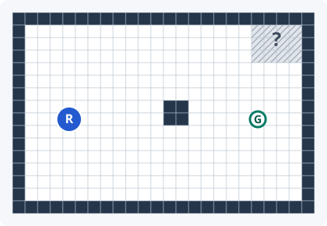
<p>壁と台車があるセルを障害物として登録する。白いセルには障害物コストが付いていない。</p>
</figure>
<figure class="costmap-picture-card">
<figcaption><strong>③ 周囲へコストを広げる</strong><span>機体の大きさと、近づきたくない度合い</span></figcaption>
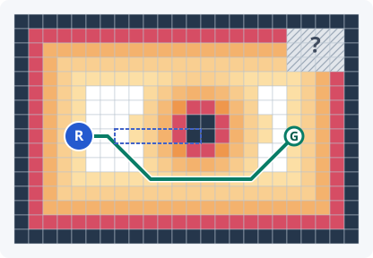
<p>赤は機体中心を置くと衝突する範囲。その外の黄～橙は、近いほど高いコストを持つ範囲。緑線は迂回経路の例。</p>
</figure>
</div>
<ul class="costmap-picture-legend" aria-label="コストマップの凡例">
<li><span class="costmap-swatch costmap-free" aria-hidden="true"></span><span><b>0</b>：障害物コストなし</span></li>
<li><span class="costmap-swatch costmap-gradient" aria-hidden="true"></span><span><b>1～252</b>：近づくほど避けたい</span></li>
<li><span class="costmap-swatch costmap-inscribed" aria-hidden="true"></span><span><b>253</b>：機体中心を置くと衝突</span></li>
<li><span class="costmap-swatch costmap-lethal" aria-hidden="true"></span><span><b>254</b>：物体がある</span></li>
<li><span class="costmap-swatch costmap-unknown" aria-hidden="true"></span><span><b>255</b>：未観測・未知</span></li>
</ul>
<figure class="costmap-cell-detail">
<figcaption><strong>③の青い点線枠を拡大：台車へ近づく6セル</strong></figcaption>
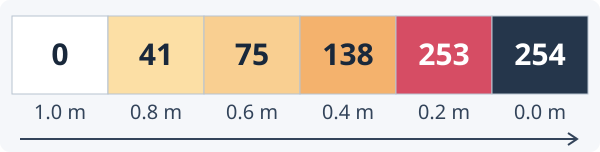
<p>数字はセルの内部コスト、下段は障害物セル中心までの距離。右へ行くほど台車に近づく。例えば<b>138のセルには物体がなくても、「台車に近いので避けたい」という値が付く。</b></p>
</figure>
<p class="costmap-picture-note">説明用に1セルを0.20 m、円形機体の半径を0.20 m、<code>inflation_radius</code>を0.80 m、<code>cost_scaling_factor</code>を3.0とした。図の色はこの教材の凡例であり、RVizの配色とは限らない。緑線は簡単な格子探索で求めた経路例で、特定のNav2プラグインの出力ではない。R・G・経路は説明用の重ね描きであり、ロボット自身を障害物セルにしているわけではない。</p>
</div>

この図で特に見るのは、**物体がある濃いセルよりも広い範囲に色が付く**点である。ロボットを点として考えると、台車のすぐ横を通る経路も作れてしまう。機体の大きさを考えた衝突領域と、余裕を取りやすくするコストの勾配を加えることで、通る場所を評価できる。黄～橙の範囲は一律の通行禁止ではなく、経路・速度の評価に使う。

これまで登場した地図は、次のように役割が異なる。

| 情報 | 答える問い | 主な利用先 |
|---|---|---|
| Localization用の3D点群地図 | 観測した形状は地図上のどこに一致するか | `lidar_localization_ros2`などの自己位置推定 |
| 保存済み2D占有地図 `/map` | 地図作成時に、どこが壁・空き・未観測だったか | StaticLayer、AMCLなど |
| コストマップ | 今の情報と機体の大きさを考えると、どこを通りたいか・避けたいか | Nav2のPlanner、Controller |

地図の名前が似ていても、渡す先は異なる。3D点群地図をLocalizerへ渡す流れと、2D占有地図をCostmapへ渡す流れを図で分けて見る。

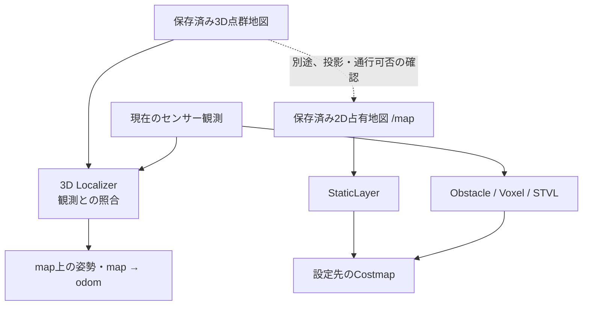

点線は別途用意する地図生成処理であり、Localizerを起動するだけで自動的に2D地図へ変換される意味ではない。STVLも障害物を記録するレイヤーであり、地図上の自己位置や`map → odom`を求める担当ではない。

LIOが内部で使う「局所点群地図」は、点群を照合して連続した移動を推定するための地図である。Nav2のLocal Costmapは移動先を評価するための格子であり、同じ「局所」という名前でも用途とデータ構造が異なる。

保存済み地図にない台車や人も、現在のセンサー観測からコストマップへ追加できる。逆に、壁の周りには物体がないセルでも高いコストを付け、壁際を避ける経路を選びやすくする。したがって、**占有地図をそのまま表示したものがコストマップ、というわけではない。**

Nav2内部の代表的なコスト値は次の通りである。

| 内部値 | 意味 | 読み方 |
|---|---|---|
| `0` | Free space | このセルに障害物コストが付いていない |
| `1～252` | 距離などに応じたコスト | 数値が高い場所を避けるよう、経路・軌道の評価へ使う |
| `253` | Inscribed inflated obstacle | 障害物から機体の内接半径以内。機体中心を置くと衝突する領域 |
| `254` | Lethal obstacle | 障害物があるセル |
| `255` | No information | 未知。単に「254より危険」という大小比較では扱わない |

これは内部の8 bit表現である。`nav_msgs/msg/OccupancyGrid`の`-1`や`0～100`とは数値体系が違い、RViz表示用Topicでは変換される。色も表示設定によるため、色だけで値を断定しない。`0`も「実世界で安全が証明された」という意味ではなく、未観測領域をFreeとして初期化する設定なら未確認の空間を含み得る。

以下は、[大域と局所の役割](#costmap-global-local) → [レイヤーの構成](#costmap-layers) → [障害物の登録・消去](#costmap-observations) → [機体形状と余裕幅](#costmap-footprint) → [回避の処理ループ](#costmap-control-loop) → [通路の具体例](#costmap-corridor)の順に読む。

### 6.5 大局・大域と局所は何が違うか {#costmap-global-local}

「大局的に考える」ときの大局を、ここではNav2の用語に合わせて**大域（Global）**と呼ぶ。大域は「目的地まで、どの通路を選ぶか」、局所（Local）は「直近で、どう動けばその経路へ進めるか」を担う。

<div class="costmap-visual" id="costmap-scope-picture">
<div class="costmap-picture-grid costmap-scope-grid">
<figure class="costmap-picture-card">
<figcaption><strong>① 大域：目的地までの通路を選ぶ</strong><span>Global Costmap / map基準 / 図の全体は8 m × 6 m</span></figcaption>

<p>壁・台車の周囲にもコストがある。Plannerは目的地Gまでを見て、距離やコストなどを評価し、この例では通路Aを通る緑の経路を作る。</p>
</figure>
<figure class="costmap-picture-card">
<figcaption><strong>② 局所：目前でどう動くかを選ぶ</strong><span>Local Costmap / odom基準 / 青枠の3 m × 3 mを拡大</span></figcaption>
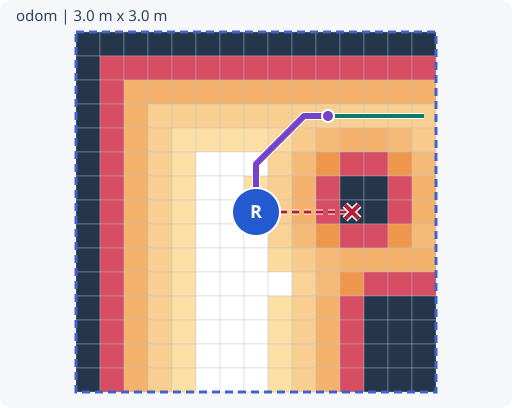
<p>Controllerは近傍のコスト、TFで変換した経路、現在姿勢・速度を使う。赤い破線の直進候補は衝突するため採用できない。紫は衝突を避けて進む短い動きの例で、これに対応する速度指令を判断する。</p>
</figure>
</div>
<ul class="costmap-picture-legend" aria-label="大域・局所図の線の凡例">
<li><span class="costmap-line-key costmap-path-key" aria-hidden="true"></span><span>緑：大域経路</span></li>
<li><span class="costmap-line-key costmap-motion-key" aria-hidden="true"></span><span>紫：直近の動きの例</span></li>
<li><span class="costmap-line-key costmap-rejected-key" aria-hidden="true"></span><span>赤い破線・×：衝突する候補</span></li>
<li><span class="costmap-line-key costmap-window-key" aria-hidden="true"></span><span>青い破線：局所窓の範囲</span></li>
</ul>
<p><strong>大域と局所で、セルのコストの意味が変わるわけではない。</strong>濃い色は障害物、赤は機体中心を置くと衝突する領域、黄～橙は近づくほど避けたい領域であり、6.4節と同じである。違うのは、主に扱う範囲・座標系と、そのコストを使って何を決めるかである。</p>
<p><strong>目的地Gが局所窓の外にあってもよい。</strong>局所側は、目的地へ続く大域経路の近傍部分を参照できる。ロボットが進むにつれて窓が移動し、次の範囲を観測・更新しながら指令を繰り返す。</p>
<p class="costmap-picture-note">範囲を比較するため、同じ観測・解像度・膨張設定を使い、mapとodomの原点・軸をそろえて描いた。実際のLocal CostmapはGlobalの画像を切り出して作るのではなく、独立したレイヤーと観測から更新する。緑・紫の線は処理の役割を示す模式例であり、実際の経路・軌道はプラグインと機体の運動制約で変わる。紫の線がコストマップ自体の出力という意味ではない。</p>
</div>

| 観点 | Global Costmap：大域 | Local Costmap：局所 |
|---|---|---|
| 主な問い | 目的地までどこを通るか | 今の周囲で、次にどう動くか |
| 典型的な範囲 | 保存地図の全体。目的地までの経路を含む | 機体周囲の数m。例：8 m × 8 m |
| 典型的な基準座標 | `map` | `odom` |
| 地図の持ち方 | 通常は固定範囲 | 通常は`rolling_window: true`で機体に追従する範囲 |
| 主な情報 | 保存地図＋現在の障害物＋周囲のコスト | 現在・最近の障害物＋周囲のコスト。必要なら保存地図も加える |
| 主な利用者 | Planner Server内の経路計画プラグイン | Controller Server内の経路追従・局所制御プラグイン |
| 利用者が出すもの | `nav_msgs/msg/Path`の経路 | 通常は`/cmd_vel`の速度指令 |

これは典型構成であり、GlobalとLocalでフレーム、範囲、解像度が必ずこの組み合わせに固定されるわけではない。パラメータの`global_frame`は「そのコストマップ全体の基準座標」という意味なので、**Local Costmapの`global_frame: odom`も正しい設定**である。

Local Costmapの窓はロボットとともに移動するが、`odom`の座標軸がロボットとともに回転するわけではない。ロボットが前進すると窓の原点が移り、新しく入った範囲を更新し、窓の外はその2Dコストマップの対象外になる。STVLの内部ボクセルなど、レイヤーが別に持つ記録まで直ちに削除されるかは別の仕組みである。8 m四方を機体中心に置けば、前方に使える長さは概ね4 mである。センサー有効距離と合わせ、停止距離やControllerの予測範囲を収める必要がある。

<div class="costmap-visual" id="map-rolling-picture">
<div class="costmap-picture-grid costmap-scope-grid">
<figure class="costmap-picture-card">
<figcaption><strong>t0：Pが局所窓の中にある</strong><span>座標軸はodomに固定</span></figcaption>
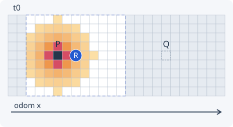
<p>青枠の中が現在の局所2Dコストマップ。灰色の外側は位置関係を示す背景で、この窓の計画用格子には含まれない。</p>
</figure>
<figure class="costmap-picture-card">
<figcaption><strong>t1：窓が右へ移動する</strong><span>PとQの物理的な位置は変わらない</span></figcaption>
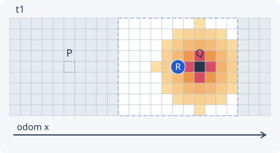
<p>Pが図の対象範囲から外れ、Qが窓に入る。これは時間減衰による消去とは別で、現実のPが消えたことも意味しない。</p>
</figure>
</div>
</div>

第2章とのつながりは、Localを`odom`にすることで近傍観測を連続した座標で蓄積し、遠方のmap上の経路はTFで局所制御側へ変換する点にある。地図補正が入れば経路との位置関係は変わり得るが、補正だけでodom上の障害物を飛ばさずに扱える。

**Global＝静的障害物だけ、Local＝動的障害物だけ、ではない。** Globalにもセンサー障害物を入れられるし、Localにも壁のような静止物体が入る。2枚の地図は、主に計画の範囲と利用目的を分けている。Localの内容がGlobalへ自動コピーされるわけでもなく、必要な観測源をそれぞれのレイヤーに設定する。

#### 大域コストマップと局所コストマップは重ね合わせるのか {#costmap-combine-question}

基本的には別々に保持する。PlannerがGlobalを使って大域経路を作り、Controllerがその経路とLocalを使って速度指令を決める。

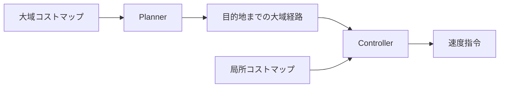

**組み合わせるのは、大域経路の近傍部分と局所の障害物情報である。** Controllerは経路を局所座標へ変換して評価する。GlobalとLocalのセル値を足し合わせて1枚にする処理ではない。RVizでは同じ座標系に変換して重ねて表示できるが、それは内部の地図を合成することとは区別する。レイヤーの合成は、それぞれのCostmapの中で次節のように行う。

### 6.6 レイヤーを重ねて1枚のコストマップを作る {#costmap-layers}

Nav2の標準的なコストマップは、複数のレイヤープラグインが共通の格子へ情報を反映する構成である。

| レイヤー | 入力と仕事 | 例 |
|---|---|---|
| `StaticLayer` | `/map`などの占有地図を読み込む | 保存地図の壁・固定設備 |
| `ObstacleLayer` | LaserScanやPointCloud2を使い、2D格子へ障害物を登録・消去する | 2D LiDARで検出した人・台車 |
| `VoxelLayer` | 高さ方向を含むボクセルで観測を扱い、2Dコストへ投影する | 3D点群の机・柱・張り出し |
| STVL | 疎な3Dボクセルと時間減衰・センサー視野で観測を管理し、2Dへ投影する | 移動する人の古い点が残る問題への対処 |
| `InflationLayer` | 障害物の周囲へ距離に応じたコストを広げる | 壁との余裕、通路中央へ寄せる傾向 |

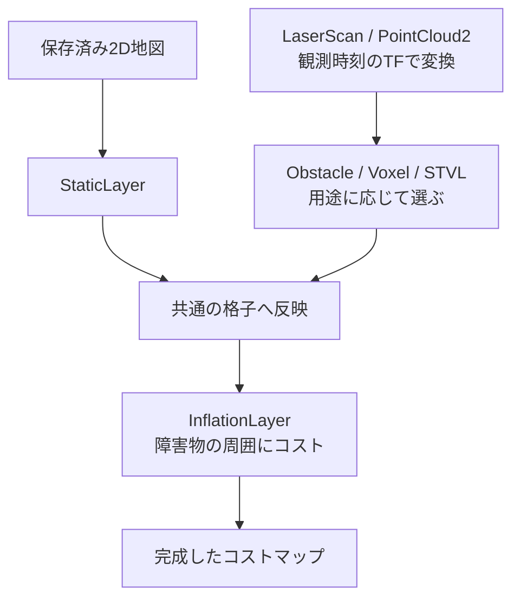

図は1枚のコストマップを作る概念図である。GlobalとLocalがそれぞれ独立に必要なレイヤーを持つ。典型的には`plugins: [static_layer, obstacle_layer, inflation_layer]`のように障害物を反映してからInflationを適用する。3D入力ならObstacleの代わりにVoxelやSTVLを選べる。STVLの実設定は第11章を参照する。

<div class="costmap-visual" id="map-layers-picture">
<div class="costmap-picture-grid costmap-scope-grid">
<figure class="costmap-picture-card">
<figcaption><strong>① StaticLayer：保存地図</strong><span>地図作成時の壁がある</span></figcaption>
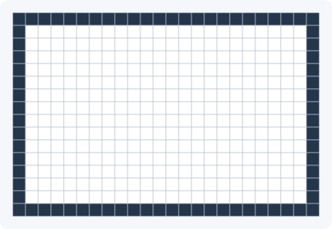
<p>保存地図には外周の壁がある。後から置いた台車はまだ入っていない。</p>
</figure>
<figure class="costmap-picture-card">
<figcaption><strong>② センサーのレイヤー</strong><span>現在観測した台車がある</span></figcaption>
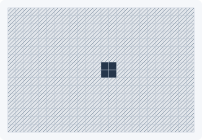
<p>ここでは台車だけを登録した状態を示す。斜線はこの層に情報がないセルで、保存地図の壁を消す指示ではない。</p>
</figure>
<figure class="costmap-picture-card">
<figcaption><strong>③ 同じ格子へ合成する</strong><span>保存地図の壁と観測した台車</span></figcaption>
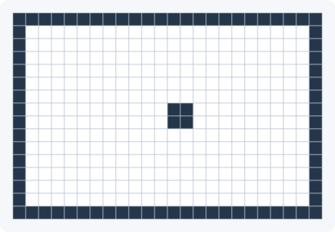
<p>この例では、未知値を特別扱いする最大値合成でStaticLayerの壁とセンサー側の台車を残す。</p>
</figure>
<figure class="costmap-picture-card">
<figcaption><strong>④ Inflationを適用する</strong><span>障害物の周囲にコストを付ける</span></figcaption>
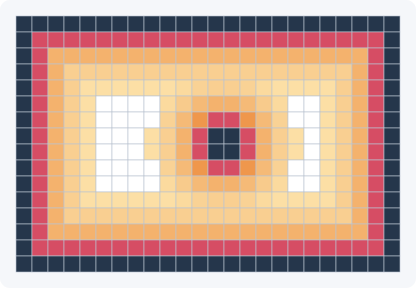
<p>合成された障害物の周囲にコストを広げる。完成した格子をPlannerやControllerが参照する。</p>
</figure>
</div>
<p class="costmap-picture-note">6.4節と同じ部屋・コストの配色を使った例。この4段階は1枚のCostmapの中の処理であり、GlobalとLocalを重ねた図ではない。例えば②から台車の記録を消せば台車由来のコストは消えるが、①にある壁は残る。</p>
</div>

重ね方は単純な足し算とは限らない。例えばObstacleLayerの`combination_method: 1`は、未知値を特別扱いしつつ高いコストを採る方式である。StaticLayerに壁が残っていれば、センサー側のレイヤーだけをFreeへ戻しても、合成後の壁は消えない。消えない障害物を調べるときは、どのレイヤーが値を供給しているかを確認する。

VoxelやSTVLが内部で3Dを扱っても、通常のNav2が参照する完成結果は2Dである。床を障害物にせず、機体が衝突する高さの障害物を残す前処理が必要であり、階段や足の着地点が自動的に計画できるわけではない。

### 6.7 観測から障害物を登録し、消すまで {#costmap-observations}

例えばLiDARの前方2 mに台車が見えたとき、標準ObstacleLayerでは概ね次の処理になる。

1. センサーの`header.frame_id`と`header.stamp`を読む。
2. **観測時刻のTF**で点とセンサー原点を対象コストマップの座標へ変換する。Localなら`odom`、Globalなら`map`が典型である。
3. 高さ・距離などの採用条件を満たす反射点のセルを障害物として登録する。これが**Marking**である。
4. センサー原点から有効な反射点へ至る光線上の空間を、障害物がない観測として更新する。これがRaytraceによる**Clearing**である。実装ではClearing後にMarkingを行い、終端の物体を残す。
5. レイヤーを合成し、障害物周囲のInflationも更新する。

<div class="costmap-visual" id="map-clearing-picture">
<div class="costmap-picture-grid">
<figure class="costmap-picture-card">
<figcaption><strong>① Aで反射：障害物を登録</strong><span>Marking</span></figcaption>
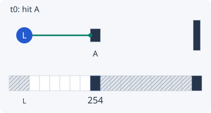
<p>反射点Aに障害物を登録する。図の下段は光線上の格子の記録で、斜線は未確認の部分。</p>
</figure>
<figure class="costmap-picture-card">
<figcaption><strong>② Aを通過：空きを観測</strong><span>Clearing</span></figcaption>
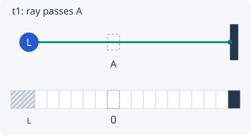
<p>新しい有効な光線がAを通って背後の壁まで届く。Aを空きとして更新できる。</p>
</figure>
<figure class="costmap-picture-card">
<figcaption><strong>③ 新しい光線が来ない</strong><span>空きと確認できていない</span></figcaption>
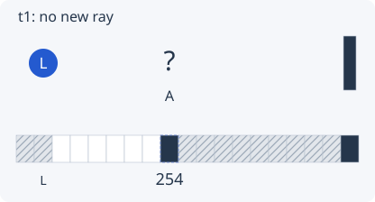
<p>遮蔽・視野外・センサー停止などでは、Aが空いたとは分からない。標準ObstacleLayerでは、別の消去処理がなければ記録が残る。</p>
</figure>
</div>
<p class="costmap-picture-note">光線とセルの対応を簡略化した図で、Inflationは省略している。右端の壁は以前から記録されているものとする。STVLの視野モデルを用いた時間減衰は、この標準Raytraceとは別の仕組みである。</p>
</div>

**点が届かなくなったことと、空いていると観測できたことは異なる。** 遮蔽で台車が見えない、センサーが別の方向を向いた、点群Topicが止まった、という理由だけでは、その場所を安全なFreeと判断できない。通常のObstacleLayerは観測されない障害物を時間だけで自動消去しない。`observation_persistence`も観測バッファの保持時間であり、格子に書いた障害物の寿命そのものではない。

`marking`と`clearing`、`obstacle_max_range`と`raytrace_max_range`を区別し、無限遠LaserScanを使う場合の`inf_is_valid`もセンサーに合わせる。PointCloud2に「点がない方向」の光線が自動生成されるとは限らない。STVLのDecayは別の消去モデルであり、消えたセルを実際に安全と確認したことにはならない。

未知領域は`track_unknown_space`で保持するかを決め、Planner側の`allow_unknown`などで通過を認めるかを決める。両者は別の設定である。探索のため未知へ進む構成と、既知の走行可能域だけを使う構成を混同しない。

#### 局所の障害物は時間経過で消えるのか {#costmap-expiry-question}

使うレイヤーと設定で異なる。次の「消える」を区別する。

| 仕組み | 何によって見えなくなるか | 図の参照先 |
|---|---|---|
| 標準ObstacleLayer / VoxelLayer | 主に有効な光線によるClearing。時間だけの自動消去ではない | [観測の3場面](#map-clearing-picture) |
| STVL | 古いボクセルを設定した時間モデルなどで期限切れにする | [STVLの時間経過](#stvl-temporal-guide) |
| Rolling Window | その場所が局所2Dコストマップの対象範囲から外れる | [移動する窓](#map-rolling-picture) |
| StaticLayerの壁 | 保存地図に残っていれば、他の層を消去しても合成結果に残る | [レイヤーの合成](#map-layers-picture) |

STVL内部のボクセル寿命、観測バッファの保持時間、2D窓の範囲はそれぞれ別の設定である。センサーが止まって記録が減衰した場合も、「空いていると観測できた」とは扱わない。

#### 新しく見つけた障害物を、いつまで残すか {#costmap-retention-policies}

**「空いていると観測できたら消し、それ以外は残す」構成も、「一定時間再観測されなければ消す」構成も選べる。** どちらになるかは、障害物を登録したレイヤーと観測源の設定で決まる。GlobalかLocalかという名前だけでは決まらない。

標準のレイヤーは、通常、物体IDを追跡して「この台車がAからBへ移動した」と判断するわけではない。**Aに書いた格子・ボクセルの記録を何の条件で消すか**を設定する。新しい障害物をCostmapへ登録しても、保存済みの占有地図ファイルへ自動的に書き込まれるわけではない。

| 方針 | 主な構成・設定 | 空きを確認する観測が来た場合 | 視野外・遮蔽などで確認できない場合 |
|---|---|---|---|
| A：空きを観測したら消す | 標準ObstacleLayer / VoxelLayer。`marking: true`、`clearing: true` | 有効なRaytraceで対象をClearする | 時間だけでは消さず、記録を残す |
| B：観測による消去を使わない | 標準ObstacleLayer。登録用は`marking: true`、その層の全観測源で`clearing: false` | 観測によるClearingは行わない | 記録を残す |
| C：再登録されなければ期限で消す | STVL。`mapping_mode: false`、`decay_model: 0`、`voxel_decay: 2.0`など。視野による加速なし | 即座のRaytrace消去にはせず、期限で扱う | 最後の登録から2秒を超えた更新で古い記録を消す |
| D：期限に加えて視野内で早く消す | STVLの線形寿命＋観測源の`clearing: true`、視野モデル、正の`decay_acceleration` | 視野モデル内の古い記録を設定に応じて早く消す | 視野外でも基本の線形寿命は進む |

表は通常の更新中の挙動である。リセット・Clearサービス・Rolling Windowから外れる処理・機体Footprint内の消去などは別に働く。Bも、再起動後まで保存する永続記録という意味ではない。VoxelLayerでは3DのボクセルをClearし、高さ方向の残り方や閾値に応じて2Dセルが変わるため、1本の光線でそのXY列が必ずFreeになるとは限らない。

同じ位置Aについて、0秒に障害物を登録し、それ以降Aへ障害物点を再登録しない場合を比べる。STVLは線形寿命2秒・加速なし、古い入力の再利用なしとする。

<figure class="costmap-visual" id="costmap-retention-unobserved-picture">
<figcaption><strong>① Aの現在状態を確認できないまま、時間だけが進む</strong></figcaption>
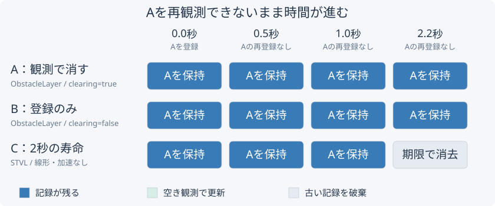
<p>Aが視野外や遮蔽の裏に入っただけでは、標準ObstacleLayerは空きを確認できない。STVLの期限切れは、空きを観測していなくても古い記録を破棄する方針である。</p>
</figure>

<figure class="costmap-visual" id="costmap-retention-clearing-picture">
<figcaption><strong>② 1秒で、有効な光線が以前のAを通り抜ける</strong></figcaption>
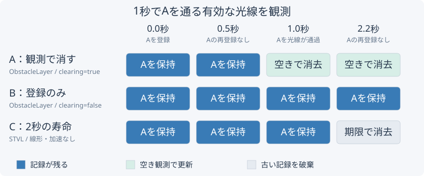
<p>Aの設定では、この観測を反映した更新で空きに戻せる。Bでは光線による消去をしない。CのSTVLは標準Raytraceとは別の方式なので、この例では2秒の期限を待つ。</p>
<p class="costmap-picture-note">青は対象レイヤーに記録がある状態、緑は有効な空き観測で更新した状態、灰色は期限切れで記録を破棄した状態。最終CostmapがFreeかUnknownかは、他の層と設定にも依存する。ROS時刻とCostmap更新が進む前提で、リセット・窓外への移動・Footprint内の消去は除いている。図は計測結果ではない。</p>
</figure>

#### A：空きを観測した場合に消し、未確認なら残す設定 {#costmap-clearing-config}

次はHumbleの標準ObstacleLayerで2D LiDARを使う例で、既存の`local_costmap.local_costmap.ros__parameters`配下へ統合する抜粋である。既存のTF・機体形状・範囲・更新周期・Inflation設定は別途必要になる。StaticLayerなども使っている場合は、`plugins`に必要な既存項目を残す。Global側へ採用する場合も、そのノードに観測源を設定する。

```yaml
plugins: [obstacle_layer, inflation_layer]
obstacle_layer:
  plugin: "nav2_costmap_2d::ObstacleLayer"
  enabled: true
  combination_method: 1
  observation_sources: scan
  scan:
    topic: /scan
    data_type: LaserScan
    marking: true
    clearing: true
    obstacle_max_range: 4.0
    raytrace_max_range: 5.0
    observation_persistence: 0.0
    expected_update_rate: 0.30
    inf_is_valid: false
```

障害物が動いた後、以前の位置を通って背後の壁などに届く有効な光線があれば、Clearできる。距離の値はセンサーに合わせる例示値で、`raytrace_max_range`を長く設定しても存在しない光線は作られない。

LaserScanの`+Inf`を「測定範囲内に反射がない有効な観測」として利用できる機器では、`inf_is_valid: true`を検討できる。センサー仕様を確認し、欠測・通信断・NaNを空きの証拠に置き換えない。PointCloud2に点がない方向についても、自動的に空きの光線が生成されるわけではない。

#### B：登録した障害物を観測だけでは消さない設定 {#costmap-mark-only-config}

Aの設定に対し、変更する部分は次のようになる。

```yaml
obstacle_layer:
  scan:
    marking: true
    clearing: false
```

この例は`scan`だけを観測源にしている。複数の観測源がある場合、同じレイヤーの別の観測源がClearingする可能性もあるため、**その層で観測による消去を止めるなら、全観測源の設定を確認する。**

一度見つけたものを保守的に残す用途に使える一方、動く人や台車の過去位置、ノイズ点も残りやすい。`clearing: false`でも、Footprint内の消去が有効ならその範囲は別途消される。明示的なリセットや窓の移動も別であり、これだけで永続的な障害物地図を作れるわけではない。

#### C：STVLで、最後の登録から2秒を超えたら消す設定 {#costmap-decay-config}

次は第11.3節のSTVL構成と同様にPointCloud2を使い、**時間による消去だけを比較しやすくした抜粋**である。AのObstacleLayerの代わりに採用する例で、センサーの高さ・有効距離、Footprint、Inflationなどは[STVLの実設定](#stvlをlocal-costmapへ設定する)に合わせて用意する。

```yaml
plugins: [stvl_layer, inflation_layer]
stvl_layer:
  plugin: "spatio_temporal_voxel_layer/SpatioTemporalVoxelLayer"
  enabled: true
  mapping_mode: false
  decay_model: 0
  voxel_decay: 2.0
  voxel_size: 0.05
  track_unknown_space: true
  mark_threshold: 1
  observation_sources: points
  points:
    topic: /navigation/obstacles
    data_type: PointCloud2
    marking: true
    clearing: false
    observation_persistence: 0.0
    clear_after_reading: true
    expected_update_rate: 0.30
    decay_acceleration: 0.0
```

`decay_model: 0`は線形モデルで、この例の`voxel_decay: 2.0`を寿命として読める。例えばAを最後に0秒で登録したなら、2秒を超えた後の更新で期限切れになる。1.5秒で再びAを登録すれば、加速なしでは3.5秒を超えるまで延びる。実際に物体が動き始めた時刻や、点群メッセージの生成時刻から単純に2秒を数える説明ではない。別のDecayモデルでは、この数値を同じ「2秒の寿命」と解釈しない。

**STVLでは`clearing: false`でも、この線形寿命による消去は進む。** 確認したHumble実装では、`mapping_mode: false`なら視野用のClearing観測が空でも時間減衰処理を行う。標準ObstacleLayerの同名設定と意味を取り違えない。`mapping_mode: true`は通常のナビゲーション用の消去処理を通らないため、この寿命の例とは別の動作になる。

記録を消しても、物体が実世界にないと確認したことにはならない。`track_unknown_space: true`や他の層の影響もあるため、期限切れが必ず「最終CostmapのFree」を意味するわけではない。

#### D：STVLで、視野内の古い記録はさらに早く消す設定 {#costmap-frustum-clearing-config}

Cに対し、観測源の設定を次のように変更すると、基本の線形寿命に視野内の減衰加速を加えられる。

```yaml
stvl_layer:
  points:
    clearing: true
    model_type: 1
    horizontal_fov_angle: 6.28
    vertical_fov_angle: 0.70
    decay_acceleration: 5.0
```

Humble系のこの例では`model_type: 1`を3D LiDARのモデルとして使っている。角度はrad単位の例示値であり、機種の実視野と取付姿勢に合わせる。Depth Cameraなどには対応するモデルを使う。詳細は[視野モデルの図](#stvl-frustum-guide)を参照する。

視野内の古い記録は、加速なしの2秒より早く消える場合がある。視野外でも、基本の線形寿命は進む。新しい点が継続して登録されれば時刻が更新される。これは標準Raytraceと同じ「そこを光線が通ったから空き」という判定ではなく、視野内の減衰を速める方式であり、遮蔽や欠測も考慮して調整する。

#### 観測バッファ・障害物の寿命・センサー断を分ける {#costmap-retention-clocks}

| パラメータ・機構 | 何を管理するか | 何を意味しないか |
|---|---|---|
| `observation_persistence` | 入力した観測をバッファへ保持する期間、s | 書き込んだ障害物セルを、その秒数後に消す設定ではない |
| `observation_persistence: 0.0` | 確認したHumble実装では最新1件を保持する | 「すぐ捨てる」「障害物の寿命が0秒」という意味ではない |
| STVLの`clear_after_reading: true` | 読み出した入力観測をバッファから取り除く | 登録済みのボクセルをその場で消す設定ではない |
| STVLの`voxel_decay` | 選択した時間モデルで記録を減衰させる値 | 全モデルで共通の固定TTLではない。上の2秒の説明は線形モデル0 |
| `expected_update_rate` | 観測が新鮮かを判定する許容更新間隔 | 障害物を自動消去する期間ではない。確認したHumble実装では**秒で指定し、Hzではない** |
| ROS時刻とCostmap更新 | 期限判定の時計と、消去処理を実行する機会 | 壁時計だけが進めば必ず消えるわけではない。シミュレーション時計や更新が止まれば消去も遅れる |

`expected_update_rate: 0.30`なら、最後の正常な観測更新から0.30秒を超えると観測が古いと判定する設定である。`0.0`はこの経過時間による鮮度チェックを行わない設定になる。障害物の保持・消去とは別に、センサー断を検知して速度指令を止める仕組みと機体側の指令タイムアウトを確認する。

特にSTVLで`observation_persistence: 0.0`かつ`clear_after_reading: false`だと、入力が止まってもバッファの最後の観測を読み続け、古い点でボクセルを再登録して寿命を更新する場合がある。逆に保持期間内の複数の古い点群を使えば、移動した物体の過去位置が再登録される場合もある。**図の「最後に登録してから2秒」を実現するには、入力の再利用を含めて設定する。** `clear_after_reading`はSTVLの設定であり、標準ObstacleLayerへそのままコピーする設定ではない。

#### ある層で消えても、最終Costmapに残る場合 {#costmap-retention-combination}

同じ場所を複数の層が障害物として持っていると、STVLだけを期限切れにしても、別の層が障害物を供給し続けることがある。

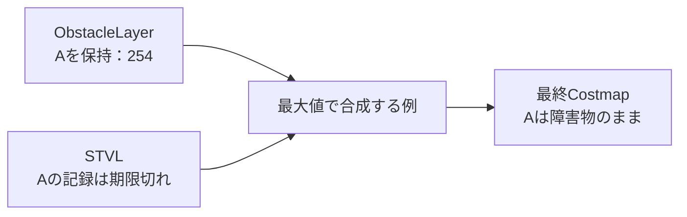

新しい障害物を一定時間で忘れたいなら、同じ動的障害物を期限なしの層にも重複登録していないかを見る。StaticLayerの保存地図にある壁も、STVLやObstacleLayerをClearするだけでは消えない。未知値の扱いと合成方法も含めて確認する。

GlobalをA、LocalをCのように設定することもできる。その場合、Localから障害物が消えてもGlobalには残り、大域経路がその場所を避け続ける場合がある。両方から同じ方針で消したいなら、各Costmapのレイヤー・観測源を設定する。Localの消去がGlobalへ自動コピーされるわけではない。

また、Rolling Windowから外れることは対象範囲が変わることであり、空きの確認ではない。ClearサービスやRecoveryでのリセットも、観測や寿命とは別の明示的な操作である。消した後に新しい観測や保存地図から再び障害物が入ることもある。

設定を比較するときは、同じ位置の障害物について「見続ける」「どけて背後を観測する」「遮蔽して見えなくする」「入力を止める」を別々に試す。元の観測、対象レイヤー、最終Costmap、鮮度判定を合わせて記録すると、消えた理由と残った理由を切り分けられる。

### 6.8 FootprintとInflation：機体の大きさと余裕をどう表すか {#costmap-footprint}

経路上の点だけが壁に重ならなくても、ロボットの角や脚が接触する場合がある。`footprint`は機体基準の多角形、`robot_radius`は円形近似であり、GlobalとLocalの両方に実際の機体形状を設定する。`footprint_padding`はその形状に加える余裕である。歩行ロボットなら、通常の脚の張り出しも含める。

Inflationは、障害物の周りに「近づくほど避けたい」という勾配を作る。機体中心からFootprint境界までの最短距離を内接半径`r_inscribed`とすると、標準Inflationの概念は次のようになる。

```text
障害物からの距離 d
  d = 0                         : 254（障害物）
  0 < d <= r_inscribed           : 253（内接半径の衝突領域）
  r_inscribed < d <= inflation_radius:
    約 252 × exp(-cost_scaling_factor × (d - r_inscribed))
  inflation_radius の外側        : この障害物による膨張コストは付けない
```

上の図式は`inflation_radius`が内接半径以上の場合であり、実際には格子の距離と整数値で計算する。`inflation_radius`はコストを広げる距離、`cost_scaling_factor`は減衰の速さであり、**後者を大きくすると、障害物から離れたときにコストが速く下がる。**

例えば半径0.30 mの円形ロボットで`inflation_radius: 0.60`なら、中心が障害物から0.30 m以内に来る領域と、0.30～0.60 mの「近づくほど高コストな領域」を区別する。0.60 m全域が一律に通行禁止になるわけではない。コストの評価方法によっては、この勾配の中にも経路が入る。

| 調整対象 | 役割 | 誤解しやすい点 |
|---|---|---|
| Footprint / 半径 | 機体が占める範囲 | 小さく偽ると、経路が通っても実機が接触する |
| Padding | 形状へ追加する余裕 | 単位はm。必要以上に増やすと通路を塞ぐ |
| Inflation | 近づきたくない度合い | 柔らかいコストの勾配を含み、全域が禁止域ではない |
| Planner / Controllerの衝突判定・重み | 形状とコストをどう評価するか | 使うプラグインやCriticによって、中心セル評価と多角形評価などが異なる |

細長い機体では、内接半径だけで旋回時の角の衝突を判定できない。機体形状に対応したPlanner・Controllerの衝突判定を選ぶ。十分な幅の通路では左右の壁からの勾配により中央へ寄りやすくなるが、中央通行を常に保証する設定ではない。

`resolution: 0.05`なら1セルは5 cmである。細かくすると細い障害物や狭い通路を表現しやすい一方、同じ面積で解像度を半分にするとセル数は4倍になる。センサー精度以上に細かくすれば正確になる、とは限らない。

#### 数値例：robot_radius 0.45 m・inflation_radius 0.80 m・係数3.0 {#costmap-radius-example}

3つの役割を、**半径0.45 mの円形ロボット、追加のFootprint Paddingなし**という条件で確認する。この数値例は、後の半径0.30 mの比較図とは別の条件である。

| パラメータ | 意味 | この例での読み方 |
|---|---|---|
| `robot_radius: 0.45` | 円形近似した機体の半径、m | 機体の直径は**0.90 m** |
| `inflation_radius: 0.80` | 障害物からコストを広げる距離、m | 障害物から**0.80 mまで**。全域が通行禁止になるわけではない |
| `cost_scaling_factor: 3.0` | 距離に対してコストを下げる速さ | 大きくすると急に下がり、小さくすると遠くまで高めのコストが残る |

<figure class="costmap-visual" id="costmap-radius-parameters-picture">
<figcaption><strong>機体の大きさ・膨張範囲・コストの減衰を分けて読む</strong></figcaption>
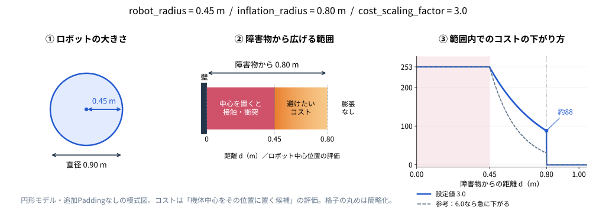
<p>色は「ロボットの<strong>中心をその位置に置く候補</strong>」の評価を示す。図の0.80 mには、機体半径に対応する0.45 mの範囲も含まれる。接触・衝突領域の外側にある帯の幅は、<code>0.80 − 0.45 = 0.35 m</code>である。</p>
</figure>

壁からロボット中心までの距離を`d`とすると、この条件では次のように読む。

| 中心までの距離 | 状態 |
|---|---|
| `0 < d <= 0.45 m` | 機体が壁に接触・衝突する範囲。理想化した円形モデルではコスト253に相当する |
| `0.45 < d <= 0.80 m` | 機体は収まるが、壁に近いので避けたいコストを付ける範囲 |
| `d > 0.80 m` | この壁による膨張コストは付かない。他の障害物やレイヤーのコストは別 |

障害物自体のセルは254である。0.45 mより外側の帯は、概ね次の式で計算する。

```text
0.45 < d <= 0.80 のとき：
  コスト ≈ 252 × exp(-3.0 × (d - 0.45))

整数化した例：d = 0.50 m → 216
              d = 0.60 m → 160
              d = 0.80 m → 88
```

`cost_scaling_factor`を変えるとこの下がり方が変わる。機体の大きさや、物理的に通れる通路幅は変わらない。

**robot_radius × 2以下の通路は通れないのか？** 円形モデルで直線通路を考えるなら、基本的にその理解でよい。この例では直径が0.90 mなので、幅0.90 m未満では壁に重なり、ちょうど0.90 mでも両側に接触するため、通行可能な余裕がない。

<figure class="costmap-visual" id="costmap-radius-corridors-picture">
<figcaption><strong>同じ直径0.90 mの機体を、幅の違う3つの通路へ置く</strong></figcaption>
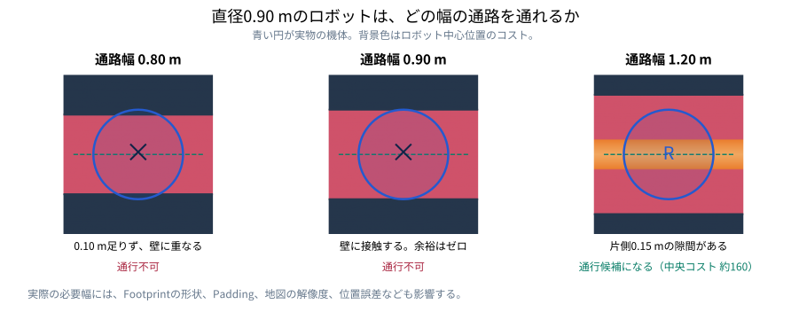
<p>幅1.20 mなら中央は壁から0.60 mで、機体表面との隙間は片側<code>0.60 − 0.45 = 0.15 m</code>になる。中央はInflationの範囲内でも、コストは約160であり、衝突しない経路の候補にできる。<strong>inflation_radiusの2倍である1.60 mまで通行禁止になるわけではない。</strong></p>
<p class="costmap-picture-note">平行な壁と円形機体を使った模式図。接触を通行可能とはみなしていない。実際には格子の解像度、壁セルの厚さ、Padding、自己位置誤差などの余裕も必要になる。</p>
</figure>

Nav2は通路幅だけを測って「0.90 m以下の通路を保存地図から削除する」処理をしているのではなく、格子上のコストと機体形状を使って経路・動作の衝突を判定する。そのため実際の判定境界は格子やプラグインの実装にも依存する。有効な多角形の`footprint`を設定している場合はその形状が使われ、`robot_radius × 2`だけで必要な幅を決められない。曲がり角では旋回中の機体形状も確認する。

#### 膨張範囲が重なると、通る場所はなくなるのか {#costmap-inflation-overlap}

**左右の壁のInflationが重なっても、それだけで通行不能にはならない。** 「コスト0の白い帯がない」ことと、「機体を置ける場所がない」ことを分けて考える。以下は半径0.30 mの円形機体、`cost_scaling_factor: 3.0`を共通にした比較である。

<div class="costmap-visual" id="costmap-inflation-comparison">
<div class="costmap-picture-grid">
<figure class="costmap-picture-card">
<figcaption><strong>① 半径が大きくても通路は残る</strong><span>幅1.00 m / inflation_radius = 1.20 m</span></figcaption>
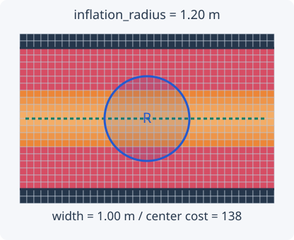
<p>中央は壁から0.50 m。理論上のコストは約138で、壁との隙間は機体の左右それぞれ0.20 m。黄色や橙でも、衝突しない経路候補になり得る。</p>
</figure>
<figure class="costmap-picture-card">
<figcaption><strong>② 半径を小さくした場合</strong><span>幅1.00 m / inflation_radius = 0.40 m</span></figcaption>
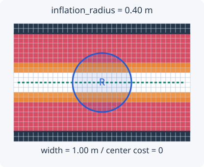
<p>中央は膨張範囲の外なのでコスト0になる。ただし物理的な隙間は①と同じ。中央へ寄せる勾配や、コストを使う近接減速の情報は少なくなる。</p>
</figure>
<figure class="costmap-picture-card">
<figcaption><strong>③ 機体より狭い通路は通れない</strong><span>幅0.50 m / 機体の直径0.60 m</span></figcaption>
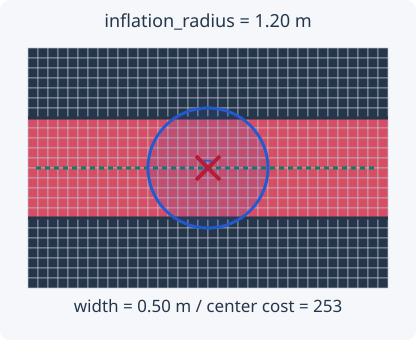
<p>円形機体が壁に重なる。Inflationを縮めたりFootprintを小さく偽ったりしても、実物が通れる幅にはならない。</p>
</figure>
</div>
<p class="costmap-picture-note">壁の線までの距離を使う理想化した断面図。格子の配置と機体位置は模式的で、実際は解像度、壁セルの厚さ、姿勢、Padding、自己位置誤差も効く。緑の破線は比較用の通路中央で、③では有効な経路ではない。</p>
</div>

同じInflationLayerでは、左右の障害物からの膨張コストは通常、高い方を残す。例えば中央に左右から138ずつ届いても、足して276にするわけではない。全域が非ゼロでも、中央が相対的に低コストなら経路選択に役立つ。ただしPlannerの探索・コスト評価、Controllerの衝突判定や運動制約によって、実際に経路が得られるかは変わる。

`inflation_radius`は「どこまで広げるか」、`cost_scaling_factor`は「その範囲内でどれだけ急に下げるか」である。あるセルが変更前後とも膨張範囲内にあるなら、半径だけを変えても、そのセルの距離コストは基本的に変わらない。

<figure class="costmap-visual costmap-cell-detail" id="costmap-inflation-curves">
<figcaption><strong>同じ半径でも、減衰係数でコストの勾配が変わる</strong></figcaption>
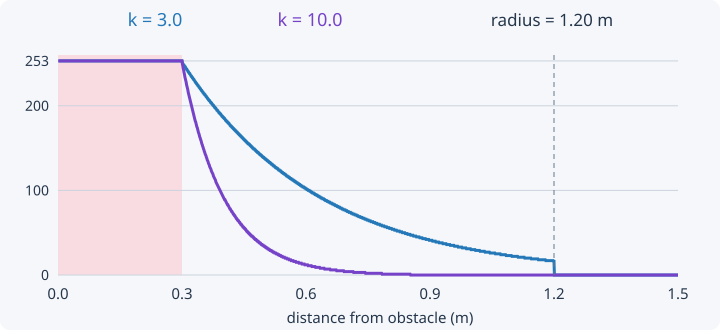
<p><code>cost_scaling_factor</code>を小さくすると、比較的遠くまで高めのコストが残る。大きくすると急に下がる。半径を広げても係数が大きすぎれば、整数化で遠くのコストが0になり、期待する勾配ができない場合がある。</p>
</figure>

「狭いので通れない」ときは、まずFootprint・Padding・壁の位置と厚さ・未知セル・Plannerの設定を確認する。非ゼロの色が見えることだけを理由にInflationを縮める必要はない。設定項目は[6.13節](#costmap-parameters)、速度との関係は[6.14節](#costmap-speed)、動的変更は[6.15節](#costmap-adaptive-inflation)で具体化する。

### 6.9 コストマップから障害物回避へ至る処理ループ {#costmap-control-loop}

典型的なNav2では、Planner ServerがGlobal Costmapを、Controller ServerがLocal Costmapを管理する。内部のプラグインが更新済みのコストマップを参照する。通常、ControllerがRViz向けの`/local_costmap/costmap`を毎回購読してから制御する構成ではない。

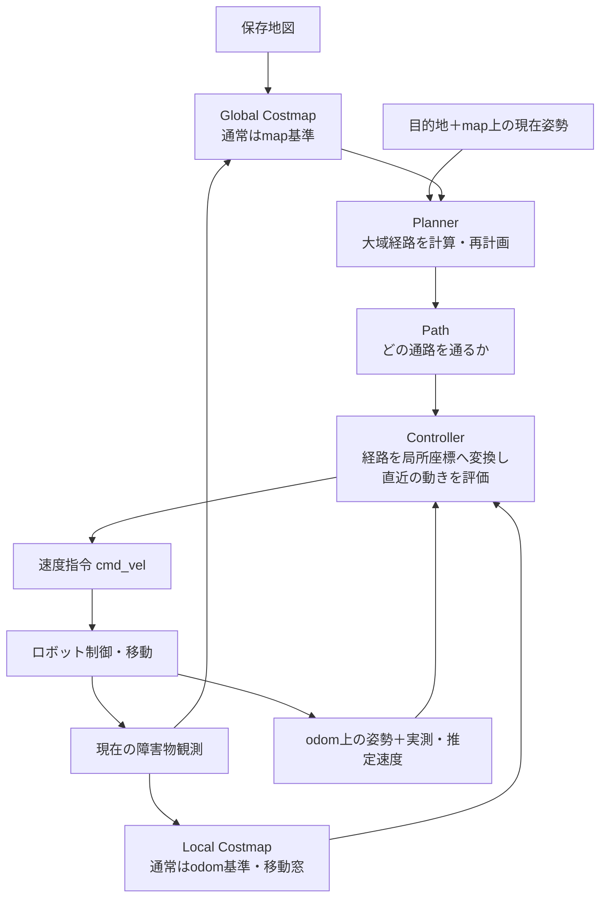

1. **観測と更新：** センサーからの障害物を各Costmapへ反映する。Localizationの新しい推定結果が来るたびだけ更新するわけではない。
2. **大域計画：** PlannerがGlobal Costmap上で、現在姿勢から目的地までの経路を求める。NavFnやSmacなど、選択した方式で距離・コスト・機体の移動制約を評価する。
3. **局所制御：** Controllerが経路、現在姿勢、現在速度、Local Costmapを使い、次の速度指令を求める。遠くの目的地が局所地図の外でも、大域経路の近傍部分を追従できる。
4. **実行と繰り返し：** ロボットが指令を実行し、次のセンサー観測とオドメトリが返る。再計画のタイミングはBehavior Tree（BT）などが制御する。

回避方法はControllerで異なる。**DWB**なら候補速度を短時間先まで進めた軌道を評価し、衝突する候補を除き、経路追従や障害物コストなどから速度を選ぶ。**MPPI**なら多数の予測軌道を評価して制御列を改善する。**Regulated Pure Pursuit（RPP）**は経路追従、減速、前方の衝突確認が中心であり、障害物の左右を探索して新しい迂回路を作る役割は主に再計画へ依存する。「Local Costmapがあれば、どのControllerでも自動で横へ回り込む」とは限らない。

動ける候補がなければ、そのまま衝突する指令を選ばせるのではなく、停止や制御失敗として扱い、BTの待機・再計画・Recoveryへ進む。実際の動作はプラグイン、失敗の許容時間、BTに依存する。CostmapのClearは記憶の消去であり、現実の障害物を取り除く操作ではない。

通常のコストマップは現在・最近の占有を表す。人の未来位置を予測して先回りする機能まで、この仕組みだけで得られるわけではない。必要なら追跡・予測を扱う追加機能と組み合わせる。計画用のCostmapと、遅延・センサー停止も扱う実機の停止系の関係は第11章で扱う。

### 6.10 時系列の具体例：通路に台車が現れたら {#costmap-corridor}

目的地へ向かう通路Aと、少し遠回りになる通路Bがある。保存地図ではどちらも通れるが、走行中にAへ台車が置かれたとする。

次の図は、6.5節の場面で、台車などが増えて通路A全体が塞がれた場合である。**「局所で止まれること」と「別の通路へ経路を変えられること」は別の処理**になる。

<div class="costmap-visual" id="costmap-replanning-picture">
<div class="costmap-picture-grid">
<figure class="costmap-picture-card">
<figcaption><strong>① Localが閉塞を検知</strong><span>局所：旧経路をそのまま進めない</span></figcaption>
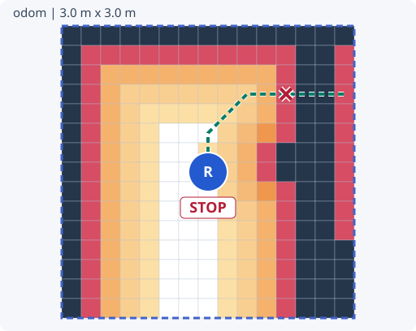
<p>追加された障害物と膨張コストで、旧経路を先へ進めない。この例では停止する。通路Bは窓の外なので、局所の短い回避だけでBの全経路を決められるわけではない。</p>
</figure>
<figure class="costmap-picture-card">
<figcaption><strong>② Globalが閉塞前のままだと</strong><span>大域：再計画してもAを選び得る</span></figcaption>
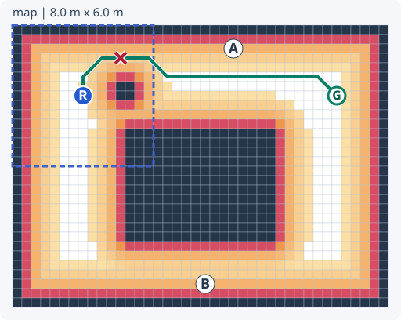
<p>Globalの格子では、Aがまだ通れる状態に見える。Localで止まっていても、同じGlobalを使う再計画ではAを選び続ける場合がある。赤い×はLocalで見つかった衝突位置の注記であり、Globalの障害物セルではない。</p>
</figure>
<figure class="costmap-picture-card">
<figcaption><strong>③ Globalへ反映して再計画</strong><span>大域：通路Bの迂回経路を選べる</span></figcaption>
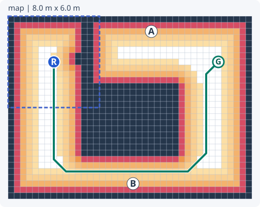
<p>Global側の障害物レイヤーにも閉塞を反映し、Plannerを再実行する。この例ではBを回る新しい経路ができ、Controllerはその近傍部分を再び追従する。</p>
</figure>
</div>
<p><strong>障害物情報をGlobalへ反映する処理と、経路を計算し直す処理の両方が必要。</strong>Localの格子を更新しただけで、Globalや経路が自動的に同じ状態へ変わるわけではない。Globalの更新と、BTなどによる再計画要求を分けて確認する。</p>
<p class="costmap-picture-note">これは処理の関係を説明するために、Localが先に閉塞を検知し、Globalが後から更新される状態を並べた図である。更新の順序・周期や停止動作は実装と設定による。図の寸法・コストの設定は6.5節と共通で、緑線は特定のNav2プラグインの実測出力ではない。</p>
</div>

| 段階 | コストマップと計画の状態 | ロボットの動作 |
|---|---|---|
| 出発前 | GlobalでAを通る経路を作る。Localには近傍の壁がある | Aへ向かう |
| 台車を観測 | 次のLocal更新で台車をMarkingし周囲へInflation | 更新後の情報を使うControllerが減速・回避・停止を判断する |
| 横に十分な空間がある | Localに機体が通れる軌道がある | 対応するControllerなら局所的に回り込み、元の経路へ戻れる |
| 通路幅いっぱいに塞がれた | Local内には通過可能な軌道がない | 無理に抜けず停止。別通路の選択には大域再計画が必要 |
| Globalにも台車が反映された | 再計画でAの閉塞を評価でき、Bの経路が得られる | 新しい経路に沿ってBへ向かう |
| 台車が移動した | 再観測によるClearingや設定した減衰で各地図を更新 | 次の再計画でAが候補へ戻り得る |

**Localにだけ台車を入れ、Globalを保存地図だけにしていると、再計画してもAを選び続ける場合がある。** Global側にも適切な障害物レイヤーを設定するなど、閉塞を大域計画へ伝える仕組みが必要である。また、観測していない遠くの閉塞をGlobalが自動的に知るわけではない。

「局所で避けられる物体」と「別の通路を選ぶ必要がある閉塞」は、同じ障害物でも機体幅、通路幅、Controllerによって変わる。局所の短い予測範囲だけで建物全体の迂回を解こうとしない。

### 6.11 更新周期とPublish周期を分けて読む {#costmap-timing}

次の数値は処理を理解するための設定例であり、Nav2の固定値や実測値ではない。

| ループ | 例 | 何が起きるか |
|---|---|---|
| センサー観測 | 10 Hz：100 msごと | 新しい点群・スキャンが届く |
| Local `update_frequency` | 10 Hz：100 msごと | 観測を取り込み、内部の局所格子を更新する |
| Global `update_frequency` | 2 Hz：500 msごと | 大域側のレイヤーを更新する |
| Costmap `publish_frequency` | Local 5 Hz、Global 1 Hz | 可視化・外部利用向けに格子をPublishする |
| Controller `controller_frequency` | 20 Hz：50 msごと | 利用可能な姿勢・速度・局所格子から指令を計算する |
| BTからの大域再計画 | 1 Hz：1秒ごと | 更新済みGlobalを使って経路を求め直す |

これらは非同期である。例えば10.00秒に観測し、10.03秒に点群が届き、10.10秒のLocal更新で反映されれば、10.15秒の制御はその障害物を利用できる。一方、10.05秒の制御時点では、その観測はまだ格子に入っていない。表の周期だけで反応時間が保証されるわけではなく、TF待ち・処理時間・実行遅延も加わる。

`publish_frequency`を上げるだけでは内部の障害物更新は速くならない。また、20 Hzで制御しても10 Hzの観測が20 Hzに増えるわけではなく、複数回の制御が同じ観測に基づくこともある。地図の更新が有効か、センサーが新鮮かの判定も必要である。

Humbleの標準的な再計画BTには`RateController`がある。**`planner_server.expected_planner_frequency`は計画時間の監視用であり、それ自体が周期的な計画要求を発行するタイマーではない。** 実際の周期は使用中のBTも確認する。

### 6.12 RVizと設定で仕組みを確認する {#costmap-checks}

RVizでは、保存地図、Global Costmap、Local Costmap、Footprint、経路、元のScan/PointCloud2を重ね、必要に応じて表示を切り替える。まずLocalを`odom`固定で観察し、近傍物体との関係が安定するかを見てから、`map`固定で大域経路との関係を確認すると分かりやすい。

```bash
# ノード名はnamespaceを含む実際の構成で確認する
ros2 node list
ros2 param get /global_costmap/global_costmap global_frame
ros2 param get /global_costmap/global_costmap plugins
ros2 param get /local_costmap/local_costmap global_frame
ros2 param get /local_costmap/local_costmap rolling_window
ros2 param get /local_costmap/local_costmap update_frequency
ros2 param get /local_costmap/local_costmap publish_frequency

# ここで測るのはTopic配信。内部更新の実行周期そのものではない
ros2 topic hz /local_costmap/costmap
ros2 topic hz /global_costmap/costmap
```

差分Publishの構成では`costmap_updates`も確認する。設定値が10 Hzでも、処理負荷で内部更新が遅れる場合はログや計測で実効周期を調べる。

| 観察・試験 | 確認したいこと |
|---|---|
| 保存地図にない箱を置く | 元の観測 → Localの障害物 → 周囲の膨張コスト、の順に見えるか |
| 箱をどけ、背後の壁を観測する | 適切なClearingで箱の痕跡が消えるか。残る場合、どのレイヤーが供給しているか |
| ロボットをゆっくり動かす | Localの窓が移っても静止した壁がodom上で安定するか |
| 通路全体を塞ぐシミュレーション | Localで停止でき、Globalへ閉塞が入り、再計画で別通路を選べるか |
| 狭い通路と旋回を確認する | Footprintと選択した衝突判定が実機形状を反映するか |

**説明できれば理解できたこと：** 地図にない箱はどのレイヤーが登録するか。箱の周りの色は何を意味するか。Localで塞がってもGlobal経路が変わらないのはなぜか。箱が観測されなくなっただけで消してよいか。この4点を、観測・コスト・計画・指令の順に説明する。

### 6.13 コストマップの主要パラメータを読む {#costmap-parameters}

Nav2全体に1個の設定があるのではなく、GlobalとLocalの各ノード、その中のレイヤーに設定がある。例えば`/local_costmap/local_costmap`の`inflation_layer.inflation_radius`と、`/global_costmap/global_costmap`の同名パラメータは別々である。`inflation_layer`はYAMLで付けたプラグインの名前なので、別名ならパラメータ名も変わる。

#### 範囲・形状・更新周期

| パラメータ | 意味・単位 | 調整すると何が変わるか |
|---|---|---|
| `global_frame` / `robot_base_frame` | 格子の基準座標 / 機体基準座標 | 典型はGlobalが`map`、Localが`odom`。機体側は実際のTFに合わせる |
| `resolution` | 1セルの辺長、m | 0.05なら5 cm。小さくすると細部を表せるが、同じ面積のセル数と処理負荷が増える |
| `width` / `height` | 格子の幅・高さ、m | Localの先読み範囲。8 m四方の中央に機体がいれば前方は概ね4 m。静的地図に合わせてサイズが決まる構成もある |
| `rolling_window` | 機体に追従して窓を移動するか | 通常Localは`true`。窓の移動と障害物の時間減衰は別 |
| `footprint` / `robot_radius` | 多角形の頂点列 / 円形近似の半径、m | 有効な多角形Footprintを指定する場合はそれを使う。円形近似なら半径を使う。形状を実機より小さくしない |
| `footprint_padding` | Footprintへ加える余裕、m | 実効的な機体形状・内接半径が変わる。狭路に対して大きすぎないか確認する |
| `update_frequency` | 内部コストマップを更新する周期、Hz | 障害物や膨張コストの更新頻度。センサーの観測頻度とは別 |
| `publish_frequency` | RVizなどへ格子を配信する周期、Hz | 表示・購読の更新頻度。これだけ上げても内部計算は速くならない |
| `track_unknown_space` | 未知セルを保持するか | 未知を通れるかはPlannerの`allow_unknown`等も関係する。未知と障害物を同じ意味にしない |

#### Inflationと障害物観測

| パラメータ | 意味・単位 | 調整の読み方 |
|---|---|---|
| `inflation_layer.inflation_radius` | 障害物から膨張コストを広げる上限距離、m | 大きいほど広い範囲を評価できる。範囲全体が禁止域になるわけではない。少なくとも実際の内接半径を覆う設定を基本とする |
| `inflation_layer.cost_scaling_factor` | 距離に対する指数減衰の係数 | **大きいほど急に下がり、小さいほど遠くまで高めのコストが残る。** 半径とセットで勾配を見る |
| `obstacle_layer.<source>.obstacle_max_range` | 反射点を障害物として採用する最大距離、m | 大きくしてもセンサーの有効距離は増えない。遠方ノイズを採用しない範囲を選ぶ |
| `obstacle_layer.<source>.raytrace_max_range` | 空きを確認する光線の最大距離、m | 有効な光線が必要。値を増やすだけで未観測方向がClearingされるわけではない |
| `<source>.marking` / `<source>.clearing` | 障害物登録 / 消去用観測に使うか | 標準Obstacle/VoxelのRaytraceとSTVLの時間・視野モデルを区別する |
| `min_obstacle_height` / `max_obstacle_height` | 採用する高さ、m | 床と自己反射を除き、機体に当たる張り出しを残す。設定階層や機能はレイヤーごとに確認する |
| `observation_persistence` | 観測バッファの保持時間、s | 格子に書かれた障害物の寿命ではない。STVLの`voxel_decay`と混同しない |

`<source>`は`scan`や`points`などの観測源名である。上表の距離パラメータは標準ObstacleLayerを例にしている。STVLへそのまま同名設定をコピーせず、[11.3節のSTVL設定](#stvl-spatial-guide)と使用バージョンを確認する。

次は既存のLocal設定に統合する**説明用の抜粋**である。`plugins`のリスト、センサートピックと観測源、Global側の設定は別途必要であり、この断片だけでBringupが完了するわけではない。以降の数値例に合わせて円形半径0.30 m、追加Paddingなしとしている。実機では形状と必要な余裕を先に決める。

```yaml
local_costmap:
  local_costmap:
    ros__parameters:
      global_frame: odom
      robot_base_frame: base_footprint
      rolling_window: true
      width: 8.0
      height: 8.0
      resolution: 0.05
      robot_radius: 0.30
      footprint_padding: 0.0
      update_frequency: 10.0
      publish_frequency: 5.0
      # pluginsには、観測用レイヤーとこのInflationLayerを含める
      inflation_layer:
        plugin: "nav2_costmap_2d::InflationLayer"
        enabled: true
        inflation_radius: 1.20
        cost_scaling_factor: 3.0
```

GlobalとLocalは同じ数値である必要はない。Globalでは通路の選択に必要な勾配、Localでは機体近傍の衝突判定とControllerが使う勾配を確認する。どちらも実際の機体形状を反映する点は共通である。

### 6.14 狭い場所で減速し、開けた場所で速度を上げる {#costmap-speed}

**InflationLayer自身は速度指令を出さない。** コストを受け取るControllerに近接減速を設定するか、区域ごとの速度制限を渡す。狭路から広場へ出たときも、他の制約がなければ設定した巡航速度へ戻るのであり、広さに比例して無制限に加速するわけではない。

| 方法 | 何を見て速度を変えるか | 主な用途 |
|---|---|---|
| Regulated Pure Pursuit（RPP）の近接減速 | 現在位置のLocalコストから推定する障害物までの距離 | 初めて見る狭い通路、近くに置かれた障害物 |
| Speed Filter | 保存した速度制限マスク上のロボット位置 | 「この廊下は40%」など、場所ごとの運用ルール |
| 独自の判断ノードから`SpeedLimit` | 観測した通路幅、視界、運用状態など | 複数の条件を統合した速度上限 |

DWBやMPPIも、コストや運動制約から軌道を評価するが、以下のRPPパラメータをそのまま設定することはできない。使用中のControllerに合う調整をする。RPPは経路追従が中心なので、障害物を見て任意の迂回経路を作る機能とは区別し、必要な大域再計画と組み合わせる。

#### RPPで障害物への近さに応じて減速する {#costmap-rpp-speed}

次は**ROS 2 HumbleのRPP**に合わせた例である。既存の`FollowPath`がDWBなどなら、同じ名前の設定に数行足すだけでは有効にならない。ControllerプラグインをRPPへ切り替え、既存のGoal Checker・Progress Checkerなどは適切に引き継ぐ。新しいNav2では設定名や機能が変わる場合がある。

```yaml
controller_server:
  ros__parameters:
    controller_frequency: 20.0
    controller_plugins: ["FollowPath"]
    FollowPath:
      plugin: "nav2_regulated_pure_pursuit_controller::RegulatedPurePursuitController"
      desired_linear_vel: 0.80
      use_cost_regulated_linear_velocity_scaling: true
      cost_scaling_dist: 0.80
      cost_scaling_gain: 1.0
      inflation_cost_scaling_factor: 3.0
      regulated_linear_scaling_min_speed: 0.10
      use_regulated_linear_velocity_scaling: true
      regulated_linear_scaling_min_radius: 0.90
      use_collision_detection: true
      max_allowed_time_to_collision_up_to_carrot: 1.0
```

| 設定 | この例での意味 |
|---|---|
| `desired_linear_vel: 0.80` | 通常目指す並進速度、m/s。他の減速条件や外部上限がなければこの値へ戻る |
| `use_cost_regulated_linear_velocity_scaling: true` | 障害物への近接による減速を使う。Humbleの既定値は`false`なので明示する |
| `cost_scaling_dist: 0.80` | 推定した障害物距離が0.80 m未満なら近接減速を行う。**Localの`inflation_radius`以下にする** |
| `cost_scaling_gain: 1.0` | 近接減速の倍率。正の値で1以下を基本とし、小さくすると対象範囲内でさらに減速する |
| `inflation_cost_scaling_factor: 3.0` | コストから距離を逆算するための係数。**Localの`inflation_layer.cost_scaling_factor`と一致させる** |
| `regulated_linear_scaling_min_speed: 0.10` | 近接・曲率による速度調整の下限、m/s。停止を禁止する値ではない。衝突判定・ゴール接近などは別に働く |
| `use_regulated_linear_velocity_scaling` / `regulated_linear_scaling_min_radius` | 急な曲がりでも減速する。後者は減速対象となる旋回半径で、障害物までの距離ではない |
| `use_collision_detection` / `max_allowed_time_to_collision_up_to_carrot` | 候補指令を将来へ進めて衝突確認する。時間上限はs、確認距離は追従点までにも制限される |

HumbleのRPPは、現在の機体基準位置にある膨張コスト`C`から、概ね次のように距離を戻す。ここで`r_inscribed`はPadding込みFootprintの内接半径である。

```text
d ≈ r_inscribed - ln(C / 252) / inflation_cost_scaling_factor

d < cost_scaling_dist のときの近接減速候補:
  v_cost = v_base × cost_scaling_gain × d / cost_scaling_dist
```

**この`d`は機体基準位置から障害物までの距離であり、機体表面の隙間ではない。** コストが0やUnknownの場合にはこの逆算をしない。別の意味のコストを同じ値域へ重ねたり、Inflationの係数を不一致にしたりすると、距離推定も期待どおりにならない。

<figure class="costmap-visual" id="costmap-speed-picture">
<figcaption><strong>同じInflationのまま、広場 → 狭路 → 広場で速度が変わる</strong></figcaption>
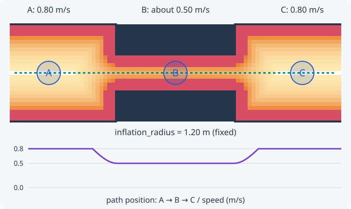
<p>A・Cでは壁が十分遠いので、この例の近接減速はかからない。Bの中央は壁から0.50 mなので、<code>0.80 × 1.0 × 0.50 / 0.80 ≈ 0.50 m/s</code>になる。半径0.30 mの機体表面の隙間は0.20 mである。</p>
<p class="costmap-picture-note">下段は説明用の速度候補であり、実測速度ではない。距離と整数コストの丸め、曲率・ゴール接近・外部速度制限・加減速制約を省略した。広い部分の幅は2.50 m。壁への距離には入口の角も影響する。</p>
</figure>

実際は近接・曲率の候補と下限、ゴール接近、外部上限などをControllerの処理順で反映する。Velocity Smootherや機体側の加減速制限もあるため、図の速度へ瞬時に切り替わるとは限らない。観測と制御の遅延を含め、必要な減速・停止距離が確保できる速度にする。

ここでInflationを0.40 mまで縮めると、壁から0.50 mの中央はコスト0になり、**コストによる近接減速が働かなくなる場合がある。** 「狭い場所ほどInflationを縮めればよい」とは限らない理由の一つである。

#### 既知の区域にはSpeed Filterで速度上限を付ける {#costmap-speed-filter}

通路が広くても人が出入りする区域は遅くしたい、といった規則にはSpeed Filterが向く。通常の占有地図とは別に速度制限用のマスクを用意する。

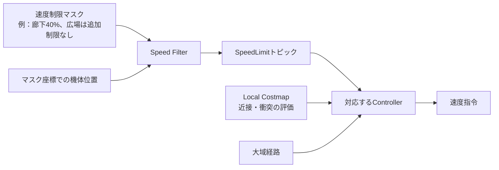

構成には、マスクを配信するMap Server、マスクの意味を配信するCostmap Filter Info Server、Costmapの`filters`に登録する`nav2_costmap_2d::SpeedFilter`、速度上限を受け取るControllerが必要になる。`inflation_layer`のパラメータだけで区域制限ができるわけではない。

Humbleでは、例えばFilter Infoを`type: 1`（百分率）、`base: 0.0`、`multiplier: 1.0`とすると、マスクの値40は40%を意味する。巡航設定0.80 m/sなら上限は0.32 m/sである。**マスク値0と`SpeedLimit.speed_limit: 0.0`は追加制限の解除であり、停止指令ではない。** 型`type: 2`は絶対速度方式で、値の換算に`base`と`multiplier`を使う。

マスクの値は画像の見た目の灰色と同じとは限らない。Map Serverの読み込みモード・閾値などで変換されるため、配信されたOccupancyGridの値を確認する。HumbleのSpeed Filterはロボットがいるセルを参照するので、狭路に入る前に十分減速できるよう、制限区域を入口より手前から設ける。マスクの範囲外へ出れば常に解除される、とも仮定せず、通常走行する領域を明示的に覆う。

独自ノードからも`nav2_msgs/msg/SpeedLimit`で上限を渡せる。Controller Serverの`speed_limit_topic`と送信先を一致させる。複数のノードが同じトピックへ競合して送ると、すべての制限の最小値へ自動統合されるわけではないため、上限を決める担当をそろえる。

### 6.15 広さに応じてInflationを動的に変えられるか {#costmap-adaptive-inflation}

**Humbleの標準InflationLayerでは、`inflation_radius`と`cost_scaling_factor`を実行中に変更できる。** ただし標準レイヤーが周囲の幅を見て自動調整する機能ではない。場所・通路幅・運用状態などを判断してパラメータを設定するノードやBT処理を別途用意する。

| 実現したいこと | 方法と範囲 |
|---|---|
| 狭い場所で遅く、開けた場所で速く | まず固定Inflation＋Controllerの近接減速やSpeed Filterを使う |
| GlobalとLocalで異なる膨張距離を使う | 各CostmapのInflationLayerへ別々の値を設定できる |
| 広い区域・狭い区域で設定を切り替える | 区域などを判断する処理から動的パラメータ更新を行う |
| 同じCostmap内で、広場セルと狭路セルに同時に違う半径を使う | 1個の標準InflationLayerの半径変更ではできない。空間ごとの処理をする独自レイヤー等が必要 |

例えば、次は説明用の広場プロファイル1.20 mから狭路プロファイル0.80 mへの変更である。6.14節の`cost_scaling_dist: 0.80`以下へInflationを縮めないようにし、係数3.0は変更しない。**幅1 mの中央の距離0.50 mは両方の膨張範囲内なので、中央の約138というコストはこの切替では変わらない。**

```bash
# ノード名・レイヤー名は実際の起動構成に合わせる
ros2 param get /local_costmap/local_costmap inflation_layer.inflation_radius
ros2 param get /global_costmap/global_costmap inflation_layer.inflation_radius

# 例：狭路プロファイル。2ノードへの変更は一括・同時ではない
ros2 param set /local_costmap/local_costmap inflation_layer.inflation_radius 0.8
ros2 param set /global_costmap/global_costmap inflation_layer.inflation_radius 0.8

# 例：広場プロファイルへ戻す
ros2 param set /local_costmap/local_costmap inflation_layer.inflation_radius 1.2
ros2 param set /global_costmap/global_costmap inflation_layer.inflation_radius 1.2
```

これは設定変更の例であり、上のコマンド列をそのまま連続実行しても、狭路を自動判定するプログラムにはならない。Global側も変えるかは計画上の必要性で決める。実行中の変更は、再起動後のYAMLを自動で書き換えるものでもない。

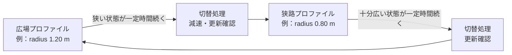

切替処理を作るときは、次の関係を維持する。

1. **実物の形状は維持する。** 通路を通したい都合でFootprintを縮めず、各プロファイルで衝突判定が成立することを確認する。
2. **速度判断に必要なコストを残す。** HumbleのRPPを使うなら`cost_scaling_dist <= inflation_radius`を保つ。係数も変えるならRPPの`inflation_cost_scaling_factor`との整合が必要になる。
3. **変更の受理と反映を区別する。** パラメータ要求の成功後、キャッシュ更新と次のCostmap更新で再膨張される。Global・Local・Controllerの変更はノードをまたぐため同時にはならない。切替中は減速・必要に応じて停止し、反映を確認してから再計画する。
4. **境界で往復させない。** 狭路へ入る閾値と広場へ戻る閾値を分け、一定時間状態が続いたら切り替えるなどのヒステリシスを入れる。センサー周期ごとの再設定は再計算負荷や経路の揺れにつながる。

最初の調整は、実機形状 → 地図・観測と解像度 → 固定Inflationの勾配 → Controllerの速度調整、の順で行う。その上で、特定の区域に異なる運用上の余裕が必要ならプロファイル切替を追加すると、何が効いているかを追いやすい。

---

## 7。学習ステップ

### Step 1：TFとトピックだけを理解する

最初はSLAMやNav2を起動せず、ロボットまたはシミュレータで次だけを確認する。

```bash
ros2 topic list
ros2 topic hz /scan
ros2 topic echo /scan --once
ros2 topic echo /odom --once
ros2 run tf2_ros tf2_echo odom base_link
ros2 run tf2_ros tf2_echo base_link laser_frame
ros2 run tf2_tools view_frames
```

合格条件：

- センサー値が継続的に出る
- `header.stamp`が進む
- `frame_id`がTFツリーに存在する
- ロボットを動かすと`odom -> base_link`が滑らかに変化する
- 停止中にOdomが大きく動き続けない

### Step 2：2D SLAMだけを動かす

最初の実機構成は次が分かりやすい。

- 2D LiDAR
- 車輪または脚のOdom
- SLAM Toolbox
- RViz
- 手動操作

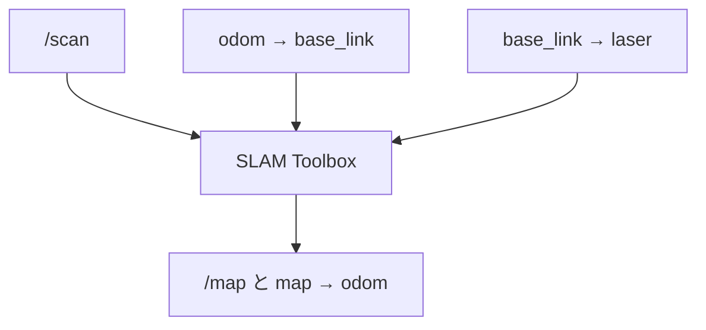

ROS 2 Humbleの基本パッケージ例：

```bash
sudo apt update
sudo apt install \
  ros-humble-navigation2 \
  ros-humble-nav2-bringup \
  ros-humble-slam-toolbox \
  ros-humble-robot-localization
```

SLAM Toolboxの起動例：

```bash
ros2 launch slam_toolbox online_async_launch.py use_sim_time:=false
```

実機のトピック名が異なる場合は、LaunchまたはParameter YAMLで`scan_topic`、`base_frame`、`odom_frame`、`map_frame`を合わせる。

地図保存例：

```bash
mkdir -p maps
ros2 run nav2_map_server map_saver_cli -f maps/site_map
```

一般に次の2ファイルが作られる。

- `site_map.yaml`
- `site_map.pgm`

SLAM Toolbox独自のPose Graphを再利用する場合は、OccupancyGrid保存とは別にシリアライズサービスを利用する。

### Step 3：保存地図でLocalizationする

地図作成を止め、Map ServerとAMCLを起動する。

```bash
ros2 launch nav2_bringup localization_launch.py \
  map:=/absolute/path/to/maps/site_map.yaml \
  use_sim_time:=false
```

RVizの`2D Pose Estimate`で初期位置を与え、次を確認する。

```bash
ros2 run tf2_ros tf2_echo map base_link
```

合格条件：

- 初期位置を与えた後、LiDARスキャンが地図の壁と重なる
- 手で押す、または走行させても位置が追従する
- 一時的に滑っても、大域位置が地図へ戻る

### Step 4：Nav2を追加する

Localizationが安定してからNav2を起動する。

```bash
ros2 launch nav2_bringup navigation_launch.py use_sim_time:=false
```

確認順序：

1. Global Costmapに地図が出る
2. Local Costmapに現在の障害物が出る
3. ロボットFootprintが正しい
4. RVizのNav2 Goalで経路が出る
5. `/cmd_vel`が出る
6. ロボットが指令どおりの方向へ動く
7. `odom -> base_link`が動作中も滑らか

いきなり実機を高速で動かさず、車輪を浮かせる、速度上限を下げる、非常停止を用意するなど、低リスク状態で方向と符号を確認する。

### Step 5：OdomをセンサーFusionへ置き換える

車輪・脚Odomだけで不足する場合は、次のような構成へ進む。

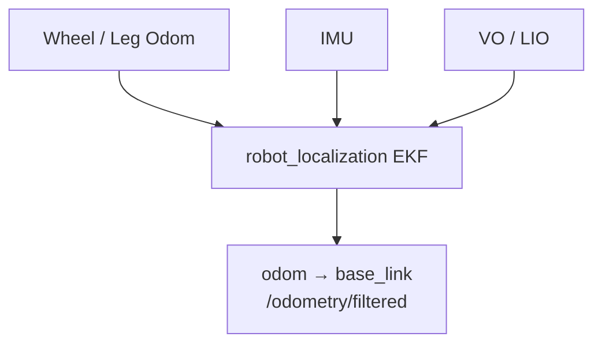

この場合、他のOdomノードからのTF Publishを停止し、EKFだけを`odom -> base_link`の所有者にする。

---

## 8。Livoxを人が持って3D地図を作る

### 8.1 推奨構成

最初に試す構成として、次を推奨する。

- Livox MID-360
- MID-360内蔵IMU
- `livox_ros_driver2`
- GLIM
- ROS 2 bag
- RVizまたはGLIM Viewer

MID-360にはIMUが内蔵されている。GLIMの公式例にもMID-360用のトピックと加速度スケール設定が示されている。

#### この構成で不要なもの

- 車輪エンコーダ
- ロボットの`/odom`
- `base_link`
- `/cmd_vel`
- Nav2

手持ち地図作成中は、センサー本体を移動体と考えればよい。必要であれば`base_link`をLiDAR/IMUユニットの基準フレームとして仮定してもよい。

### 8.2 データ経路

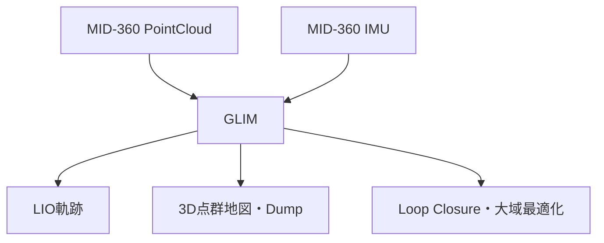

### 8.3 事前確認

実際のトピック名と型を確認する。

```bash
ros2 topic list | sort
ros2 topic type /livox/lidar
ros2 topic type /livox/imu
ros2 topic hz /livox/lidar
ros2 topic hz /livox/imu
ros2 topic echo /livox/imu --once
```

確認項目：

- `/livox/lidar`が、使用するGLIM設定に対応した点群型である
- `/livox/imu`が`Imu`として受信できる
- 点群の時刻フィールドが保持されている
- LiDARとIMUのタイムスタンプが同じ時間基準
- IMU静止時の軸方向と加速度単位が正しい

GLIM公式MID-360例では、次の設定が示されている。

```json
{
  "acc_scale": 9.80665,
  "imu_topic": "/livox/imu",
  "points_topic": "/livox/lidar"
}
```

実際には、GLIMの設定ファイル構造に従って`config_ros.json`などへ反映する。

### 8.4 まずRosbagを記録する

実時間処理だけで調整すると、同じ失敗を再現しにくい。最初はRosbagを残す。

```bash
ros2 bag record -o livox_handheld_mapping \
  /livox/lidar \
  /livox/imu \
  /tf \
  /tf_static
```

記録後に確認する。

```bash
ros2 bag info livox_handheld_mapping
```

### 8.5 GLIMで処理する

リアルタイムノード例：

```bash
ros2 run glim_ros glim_rosnode \
  --ros-args \
  -p config_path:="$(realpath ./glim_config)"
```

別ターミナルでBag再生：

```bash
ros2 bag play livox_handheld_mapping
```

GLIMにはRosbagを直接読み、処理落ちを避けながら可能な速度でマッピングする実行形式もある。

```bash
ros2 run glim_ros glim_rosbag \
  --ros-args \
  -p config_path:="$(realpath ./glim_config)" \
  livox_handheld_mapping
```

バージョンによってコマンド引数の順序が変わる可能性があるため、実際の導入時は次で確認する。

```bash
ros2 run glim_ros glim_rosbag --help
```

GLIMの標準設定では、終了時のMapping Dumpが`/tmp/dump`へ保存される。`/tmp`は一時領域なので、処理後はプロジェクト内の地図保存先へコピーする。

### 8.6 人が歩くときのコツ

1. 起動直後は数秒静止し、IMU初期化を待つ
2. LiDARとIMUが動かないよう、剛性のある治具に固定する
3. センサーを急に振らず、ゆっくり歩く
4. 壁だけでなく、柱、机、角など立体形状が入る向きにする
5. 同じ高さ・向きだけでなく、周囲形状が十分入る姿勢にする
6. 最後に開始地点へ戻り、ループ閉じ込みしやすくする
7. 人混みの少ない時間に記録する
8. 地図が崩れた箇所では、少し戻って既知領域を再観測する

#### よくある誤解

MID-360にIMUが内蔵されていても、IMUが直接、絶対位置を出すわけではない。GLIMがIMUと点群を融合し、LIOを生成する。

### 8.7 作成した3D地図をロボットのNav2で使う

次の3方式が考えられる。

#### 方式A：3D地図から2D地図を作り、AMCLを使う

1. GLIMから3D点群をPLY/PCDとして出力
2. 床、天井、ノイズを除去
3. ロボットのLiDAR高さ付近をスライス
4. 2D OccupancyGridへ変換
5. Nav2 Map Server＋AMCLで使用

長所：

- Nav2の標準構成に近い
- 実装が比較的単純

注意：

- 人が持ったセンサーの地図原点と2D地図原点を一致させる
- ロボット運用時の2D LiDARから見える壁が、地図に残っている必要がある

#### 方式B：3D地図でLocalizationし、Nav2には2D地図を渡す

1. 3D Localizerが、保存点群地図に対する6DoF姿勢を推定
2. その結果から`map -> odom`を生成
3. Nav2には、同じ`map`座標に整合した2D OccupancyGridを渡す
4. 現在障害物は3D点群からLocal Costmapへ入力

これは、3D自己位置推定の頑健性とNav2の成熟した2D経路計画を組み合わせる構成である。

#### 方式C：3D地図と3D経路計画を使う

階段、飛び石、立体足場を含めて経路を決める場合は、標準Nav2だけでは不足する。

- 3D Traversability Map
- 足場認識
- Footstep Planner
- 階段昇降状態機械
- 階ごとのNav2 Map切替

などを上位または別のPlannerとして追加する。

---

## 9。カメラを人が持ってVisual SLAMする

### 9.1 ROS 2 Humbleで始めやすい構成

次のどちらかが扱いやすい。

- RGB-Dカメラ＋RTAB-Map
- ステレオカメラ＋RTAB-Map

IMU付きカメラであれば、VIO対応構成も検討できる。単眼カメラだけでも軌跡は推定できるが、絶対スケールと追跡安定性を考えると、最初の教材にはステレオまたはRGB-Dが適している。

### 9.2 必要な入力

#### RGB-D

- RGB画像
- Depth画像
- CameraInfo
- RGBとDepthの位置関係
- 任意でIMU

#### Stereo

- 左Rectified画像
- 右Rectified画像
- 左右CameraInfo
- 正確なステレオBaseline
- 任意でIMU

### 9.3 データ経路

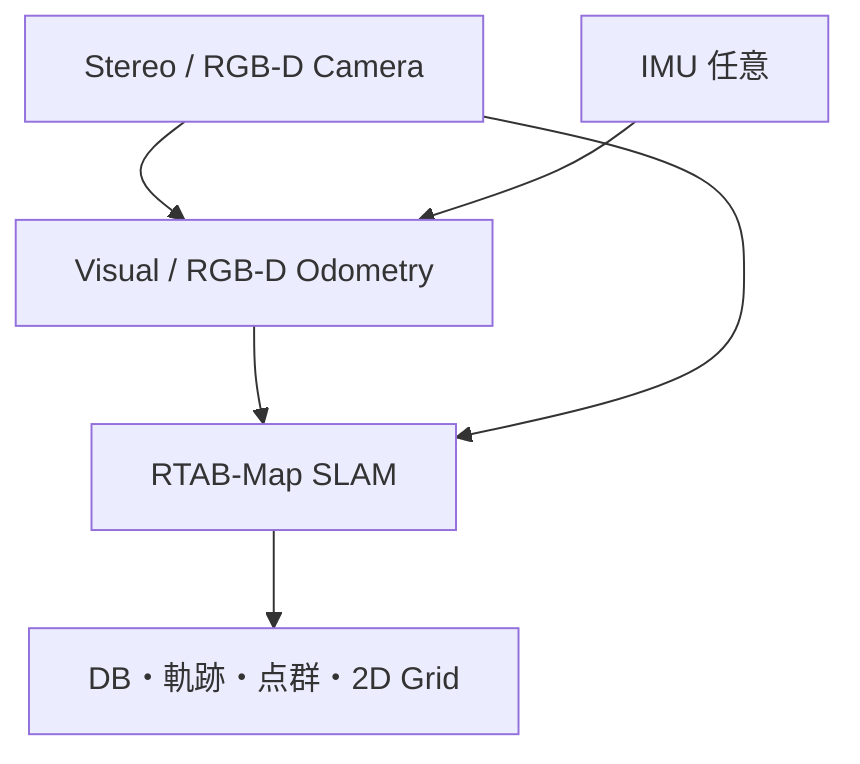

RTAB-Mapでは、Visual Odometryノードが連続姿勢を生成し、SLAMノードがループ閉じ込みと地図更新を行う構成を理解すると分かりやすい。

### 9.4 歩き方

1. 起動後、カメラを静止させる
2. 十分な明るさを確保する
3. Motion Blurを避ける
4. 真っ白な壁だけを映さない
5. カメラを床だけに向け続けない
6. 同じ場所へ戻り、似た視点から再観測する
7. RGB、Depth、左右画像、IMUの時刻を確認する

### 9.5 作った地図をロボットで使う

- RTAB-MapのDBを保存する
- ロボット運用時も互換性のあるカメラ構成を使う
- RTAB-MapをLocalizationモードで起動する
- `map -> odom`と`odom -> base_link`の担当を整理する
- RTAB-Mapの2D OccupancyGridまたは別途作成した2D地図をNav2へ渡す
- DepthまたはPointCloud2をLocal Costmapの障害物入力にする

人が持ったときとロボット搭載時で、カメラ高さや視野が大きく異なると、再ローカライズが難しくなる。ロボット運用時に近い高さと向きで地図を記録するとよい。

---

## 10。複数LiDARを使う場合

複数LiDARには2つの接続方法がある。

### 方法A：SLAM前に一つのデータへ統合する

- 各LiDARのTFを定義
- 同一時刻付近のデータを共通フレームへ変換
- 2Dなら複数LaserScanを統合
- 3DならPointCloud2を統合
- SLAMには統合済みトピックを一つ入力

長所：

- SLAM側の設定が単純

注意：

- 時刻ずれとロボット移動中の点群ゆがみ
- 重複点と死角
- 各センサーの最小・最大距離

### 方法B：SLAMへ複数センサーを個別入力する

Cartographerは、設定により複数のLaserScanまたはPointCloud2を個別入力できる。

長所：

- 各観測時刻を保ったまま処理しやすい

注意：

- ライブラリごとに複数入力対応が異なる
- SLAM Toolboxは基本的に一つのLaserScanトピックを入力するため、事前統合が分かりやすい

Nav2のCostmapでは、SLAMへの入力とは別に、複数の`observation_sources`として各センサーを登録する方法もある。

---

## 11。実機歩行ロボットで3D LiDAR障害物回避を実装する

この章では、四足歩行ロボットを想定し、3D LiDARを**自己位置推定用**と**その場の障害物検出用**に分岐して、Nav2から歩容制御へ安全に接続する。以下はROS 2 Humble向けの出発点であり、トピック名、フレーム名、可動範囲、制動距離は実機に合わせて測定する。

### 11.1 最初に決めるシステム境界

標準Nav2は基本的に平面上の`x`、`y`、`yaw`を計画する。3D LiDARを搭載しても、階段を上る足先軌道や不整地の接触計画まで自動生成するわけではない。この構成の責務を次のように分ける。

| 層 | 責務 | 停止時にも必要な出力 |
|---|---|---|
| 3D LiDAR Driver | 点群と正しい取得時刻をPublish | `/lidar/points` |
| LIO / Leg Odometry | 胴体の連続6DoF姿勢を推定 | `odom -> base_link` |
| 3D Localization | 保存地図との照合、大域補正 | `map -> odom` |
| Point Cloud前処理 | 自己反射、床、遠方、ノイズを除去 | `/navigation/obstacles` |
| Nav2 | 2D経路、局所回避、速度指令 | `/cmd_vel_nav` |
| Safety Supervisor | 転倒、通信断、近接障害物を監視 | `/cmd_vel_safe`、停止状態 |
| Gait Controller | 平面速度を安定な歩容・関節指令へ変換 | 関節指令、実行状態 |

```mermaid
flowchart LR
    L["3D LiDAR<br>/lidar/points"] --> F["Crop・Voxel・Ground filter"]
    L --> O["LIO"]
    I["IMU"] --> O
    E["Leg state"] --> O
    O --> T1["odom → base_link"]
    O --> LOC["3D Localization"]
    M["保存済み3D地図"] --> LOC
    LOC --> T2["map → odom"]
    F --> C["Nav2 local_costmap"]
    P["2D占有地図"] --> N["Nav2 Planner"]
    T1 --> N
    T2 --> N
    C --> N
    N --> V["/cmd_vel_nav"]
    V --> S["Safety Supervisor"]
    F --> S
    S --> G["Gait Controller"]
```

重要なのは、同じ点群をそのまま全機能へ渡さないことである。Localizationには壁や柱を残した点群、Costmapには実機が今衝突し得る高さ範囲の点群、Safetyには低遅延な近接点群を渡す。

### 11.2 フレームとトピックの実装契約

推奨TFツリーは次の通りである。

```text
map                         # 3D Localizerが補正
└── odom                    # 連続でジャンプしない座標
    └── base_footprint      # Nav2用。roll/pitch=0、床面上
        └── base_link       # 実際の胴体6DoF姿勢
            ├── lidar_link  # URDF固定外部パラメータ
            └── imu_link
```

実装によって`odom -> base_link`をLIOが直接出す場合は、`base_footprint`を別ノードで作る。ただし、`odom -> base_link`と`odom -> base_footprint`の両方から同じ子へ到達するループを作らない。次をBringupのインタフェースとして固定する。

| 名前 | 型 | frame | 目安周期 | 用途 |
|---|---|---|---:|---|
| `/lidar/points` | `sensor_msgs/msg/PointCloud2` | `lidar_link` | LiDAR固有 | 原点群 |
| `/imu/data` | `sensor_msgs/msg/Imu` | `imu_link` | 100 Hz以上を推奨 | LIO、転倒監視 |
| `/lio/odometry` | `nav_msgs/msg/Odometry` | `odom` / `base_link` | 20 Hz以上を目安 | 連続姿勢 |
| `/navigation/obstacles` | `PointCloud2` | センサーフレーム | 10 Hz以上を目安 | Local Costmap |
| `/cmd_vel_nav` | `geometry_msgs/msg/Twist` | なし | Controller周期 | Nav2出力 |
| `/cmd_vel_safe` | `geometry_msgs/msg/Twist` | なし | 歩容制御周期 | Safety後の指令 |

周期値は合否そのものではない。最大速度での移動量、点群遅延、TF遅延、制御周期を測り、停止までに必要な距離より安全距離を大きくする。

### 11.3 3D点群を障害物へ変換する

前処理は次の順序から始める。

1. NaNと機器仕様外の距離を除く。
2. `base_link`近傍をCropして、脚や筐体の自己反射を除く。
3. Voxel Downsampleで計算量を制限する。
4. 床面と走行可能面を除き、衝突し得る高さを残す。
5. 必要なら地面より低い点を崖・段差の別レイヤーへ渡す。
6. 元の`header.stamp`を保った`PointCloud2`をPublishする。

単純な`min_obstacle_height`だけでは、傾いた胴体から見た床を完全には除けない。床除去は重力整列フレームまたは局所地形モデルで行う。逆に、低い横木、机の天板、センサーより上の張り出しを消さないよう、**ロボット全高を覆う観測範囲**をRosbagで確認する。

実機の歩行ロボットで動的障害物を扱う場合、この教材では **Spatio-Temporal Voxel Layer（STVL）を第一候補**とする。標準`VoxelLayer`は依存関係が少なく導入確認には適するが、STVLは3Dボクセルを時間減衰でき、古い人・脚・ノイズ点がCostmapへ残り続ける問題を抑えやすい。

| 観点 | STVL | 標準`VoxelLayer` |
|---|---|---|
| 動的障害物 | 時間減衰モデルで消去しやすい | RaytraceによるClearingが中心 |
| 3D表現 | OpenVDBベースの疎な3D表現 | 高さ方向の固定Voxel数 |
| センサーモデル | 視野角・Decayを設定できる | 設定項目が比較的少ない |
| 導入 | 追加パッケージと依存関係が必要 | Nav2標準構成で始めやすい |
| 推奨場面 | 人やロボットが動く実環境、3D LiDAR | Bringup初期、静的環境、比較用Fallback |

STVLが常に正解という意味ではない。CPU・メモリ負荷、利用中のROS 2ディストリビューションに対応するブランチ、Plugin名とパラメータ名を、導入するSTVLのバージョンで確認する。最初に同じRosbagをSTVLと`VoxelLayer`へ再生し、点群停止後の残留時間、障害物の見逃し、更新周期を比較する。

#### STVLの空間：3Dの記録を2Dの障害物へ写す {#stvl-spatial-guide}

STVLは**Spatio-Temporal Voxel Layer**の略である。Spatioは3D空間をボクセルで扱うこと、Temporalはその記録を時間で管理することを表す。自己位置推定用の保存地図とは用途が異なり、観測した障害物をNav2のCostmapへ供給する。

```mermaid
flowchart TB
    PC["前処理済みPointCloud2<br/>観測時刻のTFで変換"] --> VOX["STVLの3Dボクセル<br/>占有と登録・更新時刻を保持"]
    TIME["時間減衰・視野モデル"] --> VOX
    VOX --> XY["XY列ごとに集計<br/>2Dの障害物セルへ投影"]
    XY --> MERGE["設定先のGlobalまたはLocal<br/>他レイヤーと合成"]
    MERGE --> INF["Inflation<br/>周囲へコストを広げる"]
```

<div class="costmap-visual" id="stvl-spatial-picture">
<div class="costmap-picture-grid">
<figure class="costmap-picture-card">
<figcaption><strong>① 3D点群を受け取る</strong><span>床除去・高さ範囲の選別後</span></figcaption>
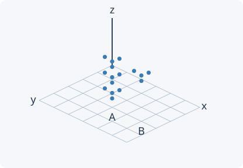
<p>Aには高さの異なる点があり、Bには高い位置だけに点がある。Bのような張り出しも、機体が当たる高さなら残す。</p>
</figure>
<figure class="costmap-picture-card">
<figcaption><strong>② ボクセルへ登録する</strong><span>占有と更新時刻を保持</span></figcaption>
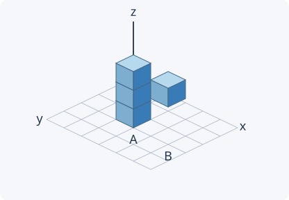
<p>小さな箱ごとに障害物の記録を持つ。再び点が登録されると、そのボクセルの更新時刻も新しくなる。</p>
</figure>
<figure class="costmap-picture-card">
<figcaption><strong>③ XYの障害物セルへ投影</strong><span>Nav2が参照する2Dの格子へ</span></figcaption>
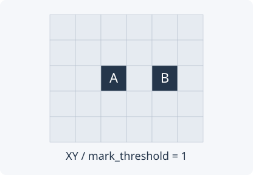
<p>例として<code>mark_threshold: 1</code>なら、採用した高さにボクセルが1個以上ある列を障害物にできる。A・BそれぞれのXY位置に対応するセルが障害物になる。</p>
</figure>
</div>
<p class="costmap-picture-note">青い点・箱は3Dの記録を示す色で、6.4節のコスト値の配色ではない。③の濃いセルが2D障害物に対応し、灰色はこの図で障害物記録を描いていない列である。灰色を観測済みFreeと断定しない。実際の投影は高さ範囲・閾値・他レイヤーの設定に従う。</p>
</div>

同じXY列に複数のボクセルがある場合、1個が期限切れになっても、残った個数が`mark_threshold`を満たす間は2D障害物が残り得る。3Dで記録が1個消えることと、2Dのセルが消えることも一対一ではない。

#### STVLの時間：古い記録が残り、期限を超えると消える {#stvl-temporal-guide}

次は、障害物が位置AからBへ移動した例である。**`decay_model: 0`、`voxel_decay: 2.0`の線形モデル、減衰の加速なし**とし、Aは0秒以降に再登録されず、Bは移動後も新しい観測で登録され続けると仮定する。時刻はボクセルの登録・更新を基準にした説明用の値であり、既定値や実測値ではない。

<div class="costmap-visual" id="stvl-decay-picture">
<div class="costmap-picture-grid">
<figure class="costmap-picture-card">
<figcaption><strong>t = 0.0秒：Aを観測</strong><span>Aの記録を登録する</span></figcaption>
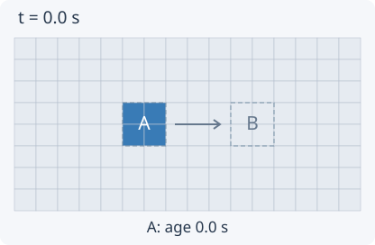
<p>Aのボクセルを登録する。Bの破線枠は、後で移動する位置を示す注記。</p>
</figure>
<figure class="costmap-picture-card">
<figcaption><strong>t = 1.0秒：物体はBへ移動</strong><span>Aの古い記録もまだ残る</span></figcaption>
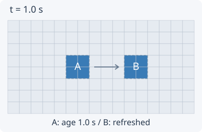
<p>Bを登録しても、Aを即座に消すとは限らない。Aは最後の登録から1秒なので、この例では期限内。</p>
</figure>
<figure class="costmap-picture-card">
<figcaption><strong>t = 2.2秒：Aが期限切れ</strong><span>Bは再観測により残る</span></figcaption>

<p>Aの記録は時間条件を満たした更新で削除される。Bは更新時刻が新しくなり続けるため残る。</p>
</figure>
</div>
<p><strong>これは「古い記録の寿命」であり、障害物コストを時間に比例して254→138→0へ下げる図ではない。</strong>残るボクセルから2Dの障害物を作り、その周囲の距離に応じたコストはInflationが計算する。</p>
<p class="costmap-picture-note">青はこのSTVL層のボクセル記録、灰色はその記録がない状態。Aの記録がなくなった後の最終セルがFree・Unknown・他レイヤー由来の障害物のどれになるかは、合成方式などで決まる。センサー停止でも記録が期限切れになる場合があるため、消えたことを「空いていると観測した」とは扱わない。</p>
</div>

<figure class="costmap-visual costmap-cell-detail" id="stvl-lifetime-picture">
<figcaption><strong>再観測すると、その場所の記録の寿命も更新される</strong></figcaption>

<p>青いバーは記録が残る期間を示す。最上段は新しいClearing・リセットなどがない場合。下2段は同じ2秒の線形寿命で、紫の縦線は1.5秒での再登録を表す。実際の削除は期限を超えた後の更新処理で起きる。</p>
</figure>

`observation_persistence`は入力の観測バッファの保持時間、`voxel_decay`は時間モデルに使う値であり、同じものではない。上の図は古い観測を再利用してAを再登録しない前提である。実機では`clear_after_reading`なども含め、観測の再利用とボクセルの更新時刻を確認する。

#### 視野モデル：古い記録の減衰を速める範囲 {#stvl-frustum-guide}

STVLは通常のRaytraceと同一の方法で空間を消すのではなく、センサーの視野モデル（Frustum）内にある古いボクセルの減衰を、設定に応じて加速できる。Depth Cameraや3D LiDARの視野形状・取付姿勢をモデルに反映する。

<figure class="costmap-visual costmap-cell-detail" id="stvl-frustum-picture">
<figcaption><strong>視野モデル内のAと、外側のB</strong></figcaption>

<p>Aは視野モデル内なので、<code>decay_acceleration</code>などの設定に応じて減衰を速める対象になり得る。Bは視野外でも、通常の時間モデルによる期限切れは起こり得る。新しい点が登録され続ける物体は更新時刻が新しくなる。</p>
<p class="costmap-picture-note">実際の3D視野を平面で簡略化した図。視野モデルの内側でも、遮蔽・反射特性・欠測によって物体が見えないことがある。視野内という条件だけで、空き領域が証明されるわけではない。以下のYAMLでは加速を設定しているため、加速なしの2秒の時系列図と消去時刻が一致するとは限らない。</p>
</figure>

#### STVLをLocal Costmapへ設定する

次はROS 2 Humble系STVLで使う構成の出発点である。センサーモデルの視野角は例示値をコピーせず、LiDARの仕様と取付姿勢に合わせる。

```yaml
local_costmap:
  local_costmap:
    ros__parameters:
      global_frame: odom
      robot_base_frame: base_footprint
      update_frequency: 10.0
      publish_frequency: 5.0
      rolling_window: true
      width: 8.0
      height: 8.0
      resolution: 0.05
      footprint: "[[0.38, 0.24], [0.38, -0.24], [-0.38, -0.24], [-0.38, 0.24]]"
      plugins: [stvl_layer, inflation_layer]

      stvl_layer:
        plugin: spatio_temporal_voxel_layer/SpatioTemporalVoxelLayer
        enabled: true
        voxel_decay: 2.0
        decay_model: 0
        voxel_size: 0.05
        track_unknown_space: true
        unknown_threshold: 15
        mark_threshold: 1
        update_footprint_enabled: true
        combination_method: 1
        origin_z: -0.10
        publish_voxel_map: true
        transform_tolerance: 0.20
        mapping_mode: false
        observation_sources: lidar3d
        lidar3d:
          topic: /navigation/obstacles
          data_type: PointCloud2
          marking: true
          clearing: true
          obstacle_range: 5.0
          min_obstacle_height: 0.08
          max_obstacle_height: 1.90
          expected_update_rate: 0.10
          observation_persistence: 0.0
          inf_is_valid: false
          filter: voxel
          voxel_min_points: 1
          clear_after_reading: true
          model_type: 1
          vertical_fov_angle: 0.70
          horizontal_fov_angle: 6.28
          decay_acceleration: 5.0

      inflation_layer:
        plugin: nav2_costmap_2d::InflationLayer
        inflation_radius: 0.55
        cost_scaling_factor: 4.0
      always_send_full_costmap: true
```

`model_type`、視野角、Plugin識別子などはSTVLのリリースによって差があり得る。起動ログの「plugin class not found」や未宣言パラメータを無視せず、実際に導入したバージョンのREADME・サンプル設定と`ros2 pkg prefix spatio_temporal_voxel_layer`で確認する。

調整は次の順序で行う。

1. `voxel_size`をCostmap解像度と同程度から始め、CPU負荷と細い障害物の検出を比較する。
2. `voxel_decay`を「観測が消えたら即座に開通」させず、センサー1～数周期の欠落を吸収できる値から試す。
3. `mark_threshold`と`voxel_min_points`を上げ過ぎて、細い脚・柱・手すりを消していないか確認する。
4. `vertical_fov_angle`と`horizontal_fov_angle`を実センサーに合わせ、観測していない空間をClearしない。
5. 点群入力を意図的に停止し、Safety SupervisorがSTVLのDecayを待たずに停止することを確認する。

`footprint`は胴体だけでなく、通常歩容で脚が掃く領域を覆う。旋回時や横歩きで張り出しが変わる機体は最大包絡形状から始める。STVLの`clearing: true`も、点群の観測原点までTFが引け、センサー視野が正しくモデル化されていることが前提である。Decayは「障害物が安全に消えた」ことを保証しないため、Safety SupervisorのSensor Timeoutを置き換えてはならない。

#### 標準VoxelLayerへ戻す判断

STVLの追加依存関係をまだ実機イメージへ固定できない、計算資源が不足する、または静的障害物だけでBringupを進めたい場合は、標準`nav2_costmap_2d::VoxelLayer`をFallbackとして使う。その場合も`marking`と`clearing`を分けて確認し、点群断をCostmapのClear扱いにはしない。まず標準LayerでTF・点群・Footprintを検証し、同じBagでSTVLへ差し替えると原因を切り分けやすい。

Global Costmapには、保存済み2D占有地図を`StaticLayer`で読み込む。3D地図から2D地図を生成するときは、床からロボット全高までを投影し、通行不能な穴や段差を別途反映する。Local Costmapは直近の速度判断、Global Costmapは目的地までの通路選択へ使う。通路を塞ぐ台車などを再計画へ反映するには、Global側にも適切な障害物レイヤーを設ける。Localの障害物が自動的にGlobalへコピーされるわけではない。レイヤーの意味と回避の処理は[第6章](#costmap-guide)を参照する。

### 11.4 Nav2から歩容制御へ接続する

Nav2の`/cmd_vel`を関節へ直接接続しない。Adapterは少なくとも次を行う。

- `linear.x`、`linear.y`、`angular.z`を機体座標の歩容指令へ変換する。
- 歩容が対応しない自由度をゼロにする。
- 速度、加速度、角加速度、Jerkを歩容の安定範囲へ制限する。
- 指令Timeout時はゼロ速度へ遷移する。
- 歩容未確立、転倒、保護停止中は非ゼロ指令を拒否する。
- 非常停止はROS 2ノードとは独立した安全回路でも成立させる。

Nav2側でも速度を制限するが、実機Safety SupervisorとGait Controllerでも必ず再制限する。設定例：

```yaml
controller_server:
  ros__parameters:
    controller_frequency: 20.0
    min_x_velocity_threshold: 0.01
    min_y_velocity_threshold: 0.01
    min_theta_velocity_threshold: 0.01
    FollowPath:
      plugin: dwb_core::DWBLocalPlanner
      min_vel_x: -0.10
      max_vel_x: 0.35
      max_vel_y: 0.20
      max_vel_theta: 0.60
      acc_lim_x: 0.30
      acc_lim_y: 0.25
      acc_lim_theta: 0.50
      decel_lim_x: -0.50
      decel_lim_y: -0.40
      decel_lim_theta: -0.80
```

これらは安全値ではなく例である。係留、吊り下げ、低速、保護具の順に試験し、実測した安定限界より十分低く設定する。後退・横歩きできない機体では、該当速度を許可せず、PlannerとControllerの運動モデルも一致させる。

### 11.5 Safety Supervisorと停止距離

Costmapは経路計画用であり、単独の安全装置ではない。Safety SupervisorはNav2より下流に置き、最新の近接観測、姿勢、歩容状態、通信Heartbeatを使って`/cmd_vel_nav`を許可・減速・停止する。

停止距離は概算でも記録する。

```text
d_stop = v * (t_sensor + t_filter + t_network + t_control) + v^2 / (2 * a_brake) + margin
```

- `v`：試験する最大速度
- `t_*`：センサー取得から歩容制御反映までの最悪値
- `a_brake`：転倒せず停止できる実測減速度
- `margin`：点群の死角、足の振り出し、時刻揺らぎを含む余裕

警告距離と停止距離は、この値より大きく取る。ROS時刻が停止・逆行した場合、点群がTimeoutした場合、TFが期限内に得られない場合は、**障害物なし**ではなく停止側へ倒す。

### 11.6 起動順序とLifecycle

実機では一括起動してすぐ歩かせず、次のゲートを通す。

1. Hardware E-stopを押した状態で、LiDAR、IMU、関節状態を起動する。
2. 静止状態でIMU BiasとLIOを初期化する。
3. TFが単一ツリーになり、点群がRViz上でロボット運動と一致することを確認する。
4. 3D Localizationを起動し、初期姿勢と整合度を確認する。
5. Costmapを起動し、既知・未知・障害物・Clearingを確認する。
6. Nav2 LifecycleノードをActivateする。
7. Safety Supervisorを最後にArmし、最初は速度上限を低くする。
8. 目視範囲内の単一Goalから試験する。

```bash
# 接続契約を確認
ros2 topic hz /lidar/points
ros2 topic delay /lidar/points
ros2 topic hz /lio/odometry
ros2 run tf2_ros tf2_echo odom base_footprint
ros2 run tf2_ros tf2_echo base_link lidar_link

# 点群とCostmapを確認
ros2 topic echo /navigation/obstacles --once
ros2 topic echo /local_costmap/costmap --once

# Nav2を有効化する前に、指令の行き先と停止を確認
ros2 topic info /cmd_vel_nav --verbose
ros2 topic hz /cmd_vel_safe
```

Launchは責務別にIncludeし、Navigation終了時や例外時にはSafety側がTimeoutで停止できるようにする。

```python
# my_robot_bringup/launch/autonomy.launch.py の構成例
from launch import LaunchDescription
from launch.actions import IncludeLaunchDescription, RegisterEventHandler
from launch.event_handlers import OnShutdown
from launch_ros.actions import Node


def generate_launch_description():
    pointcloud_filter = Node(
        package="my_robot_perception",
        executable="pointcloud_filter",
        parameters=["config/pointcloud_filter.yaml"],
        remappings=[("points_in", "/lidar/points"),
                    ("points_out", "/navigation/obstacles")],
    )
    safety = Node(
        package="my_robot_safety",
        executable="velocity_supervisor",
        parameters=["config/safety.yaml"],
        remappings=[("cmd_vel_in", "/cmd_vel_nav"),
                    ("cmd_vel_out", "/cmd_vel_safe")],
    )
    # 実装ではsensor、odometry、localization、navigationも
    # IncludeLaunchDescriptionで明示的に追加する。
    return LaunchDescription([pointcloud_filter, safety])
```

上の例は構成を示す骨格であり、そのまま完成品として使わない。特に相対パスは実装時に`ament_index_python`でPackage Shareから解決する。

### 11.7 段階試験と合格条件

| 段階 | 試験 | 合格条件の例 |
|---|---|---|
| 1。静止 | 10分間の点群、IMU、TF記録 | TF競合なし、時刻逆行なし、Odomの異常跳躍なし |
| 2。吊り下げ | `/cmd_vel_safe`の符号とTimeout | 全軸の向きが正しく、通信断でゼロになる |
| 3。係留低速 | 直進、旋回、横歩き | Costmap上の軌跡と実機が一致する |
| 4。固定障害物 | 箱、細い柱、机の張り出し | 接触せず停止または回避し、消失後にClearingする |
| 5。動的障害物 | 横切る人形など管理された対象 | 再計画または停止し、振動指令を出さない |
| 6。異常注入 | 点群停止、TF停止、Localization跳躍 | 規定時間内に停止し、勝手に再発進しない |
| 7。長時間 | 実運用コースを反復 | CPU、遅延、Localization品質が上限内 |

試験ごとに`/tf`、`/tf_static`、点群、Odom、Costmap、Nav2 Action、入力と出力の両`cmd_vel`、Safety状態、関節状態をRosbagへ保存する。障害物との最小距離、停止時間、最大姿勢角、再計画回数を同じスクリプトで集計し、パラメータ変更前後を比較する。

### 11.8 実機で起きやすい失敗

| 症状 | 確認箇所 | 対策 |
|---|---|---|
| 歩行の上下動で床が障害物になる | 点群処理フレーム、IMU重力方向 | 重力整列後に床除去し、胴体固定の高さ閾値だけに頼らない |
| 脚がCostmapへ映る | LiDAR外部パラメータ、自己マスク | 最大可動域を自己マスクし、実障害物まで消していないか確認 |
| 旋回時に壁が二重になる | Deskew、時刻同期、LIO | Hardware timestampとIMU同期を修正する |
| 障害物が消えず詰まる | Clearing、観測原点、Persistence | Raytrace可能なTF、Range、保持時間を見直す |
| 障害物を消し過ぎる | 遮蔽、Downsample、Clearing | 原点から観測できた空間だけClearする |
| Localization補正で指令が跳ねる | TF所有者、Controller frame | Local Costmapは`odom`、大域補正は`map -> odom`へ分離する |
| 狭路で左右に振動する | Footprint、Inflation、速度制限 | 脚包絡を反映し、角速度と加速度を落としてCriticを調整する |
| 点群断で走り続ける | Watchdog設計 | Sensor timeoutをSafety停止条件にする |

### 11.9 最小構成から発展する判断

- 平坦な屋内であれば、3D点群を2D Costmapへ投影する構成から始める。
- 坂や緩い起伏では、局所標高、傾斜、粗さをTraversability Costへ変換する。
- 穴、崖、階段では、正の障害物検出だけでなくNegative obstacle検出を追加する。
- 脚の接地点を個別に選ぶ必要がある地形では、Nav2は大域経路までとし、局所はFootstep / MPC Plannerへ委譲する。
- 人と同じ空間で運用する場合は、Costmap調整とは別にリスクアセスメント、安全規格、速度・力制限、独立停止系を設計する。

この境界を守ると、Nav2を「3D歩行制御器」に見立てず、2Dの目的地移動、3D知覚、歩容安定化、安全停止を個別に検証できる。

---

## 12。最小Bringup構成

パッケージを次の責務に分けると、SLAM方式を変更しやすい。

```text
my_robot_description/
  urdf/
    robot.urdf.xacro

my_robot_bringup/
  launch/
    sensors.launch.py
    base_control.launch.py
    odometry.launch.py
    slam_2d.launch.py
    slam_3d.launch.py
    localization.launch.py
    navigation.launch.py
  config/
    ekf.yaml
    slam_toolbox.yaml
    nav2.yaml
    glim/
  rviz/
    mapping.rviz
    navigation.rviz
```

責務：

- `sensors.launch.py`：LiDAR、カメラ、IMU
- `base_control.launch.py`：`/cmd_vel`から実機制御
- `odometry.launch.py`：Wheel/Leg Odom、LIO、VIO、EKF
- `slam_2d.launch.py`：SLAM Toolboxなど
- `slam_3d.launch.py`：GLIMなど
- `localization.launch.py`：AMCLまたは3D/Visual Localization
- `navigation.launch.py`：Nav2

---

## 13。デバッグの順序

SLAMが動かないとき、パラメータを無作為に変更するのではなく、入力から順に確認する。

### 13.1 推奨確認順

1. センサートピックが存在する
2. メッセージ型が合う
3. 周期が安定している
4. `header.stamp`が正しい
5. `frame_id`が正しい
6. センサーTFがある
7. `odom -> base_link`がある
8. Odomが滑らか
9. SLAM単体で地図が出る
10. `map -> odom`が出る
11. Localization単体が安定する
12. Nav2 Costmapが出る
13. Pathが出る
14. `/cmd_vel`が出る
15. 実機が正しい方向へ動く

### 13.2 症状別チェック

| 症状 | 主な原因候補 |
|---|---|
| 地図がまったく出ない | Topic名、型、QoS、TF、時刻、最小移動量 |
| RVizでMessage Filter drop | TF不足、古い時刻、処理遅延 |
| 壁が二重・波打つ | Odom誤差、時刻ずれ、Deskew不足、外部パラメータ |
| 地図全体が回転・傾斜 | IMU軸、重力方向、LiDAR-IMU回転 |
| ループ後に地図が壊れる | 誤ループ検出、初期Odom不良、特徴不足 |
| `base_link`が瞬間移動 | 複数TF Publisher、ローカルOdomのリセット |
| `map`基準だけ補正される | ループ閉じ込みなら正常 |
| Nav2に地図は出るが動かない | Localization、Lifecycle、Costmap、Controller、`cmd_vel` |
| 経路は出るが逆に動く | 車輪・歩容制御の軸または符号 |
| その場で回り続ける | Yaw Odom、TF軸、Goal向き、Controller設定 |
| Visual Odomが頻繁にLost | 暗所、白壁、Blur、CameraInfo、画像同期 |
| LIO開始直後に飛ぶ | IMU初期化、単位、軸、時刻Offset、Extrinsic |

### 13.3 Rosbagで再現する

SLAM開発では、問題のあるセンサーデータをBagに残す。

```bash
ros2 bag record -o slam_debug \
  /scan \
  /points \
  /imu/data \
  /odom \
  /tf \
  /tf_static
```

カメラを使う場合は、画像とCameraInfoも追加する。Bagを使うと、同じ入力に対してパラメータだけを変更して比較できる。

---

## 14。実機導入の合格基準

### 14.1 Odom

- 直進時に横方向へ大きく流れない
- その場旋回後、位置が大きく飛ばない
- 停止時に姿勢が振動しない
- TFの周期がNav2の制御周期に対して十分
- covarianceが不自然にゼロ固定ではない

### 14.2 SLAM

- 同じ壁が二重にならない
- 開始地点へ戻ったとき、ループが閉じる
- ループ補正後も局所運動は滑らか
- 地図解像度がロボットサイズに合う
- 動く人を地図の固定障害物として大量に残さない

### 14.3 Localization

- 再起動後に初期位置を設定できる
- 走行中にLiDAR/点群/画像が地図と一致する
- 一時的なスリップ後に復帰する
- 誘拐状態から再ローカライズできるか、運用上の復旧手順がある

### 14.4 Nav2

- Global/Local Costmapが正しい
- Footprintが実機外形を覆う
- 目的地まで経路を生成する
- 障害物前で停止・回避する
- Controllerがロボットの旋回特性に合う
- 非常停止後に安全に復旧できる

---

## 15。推奨学習コース

### コースA：まずNav2まで一通り理解する

1. シミュレータまたは2D LiDAR実機でTF確認
2. 車輪/脚Odom確認
3. SLAM Toolboxで2D地図作成
4. 地図保存
5. AMCLでLocalization
6. Nav2でGoal送信
7. `/cmd_vel`を実機制御へ接続

このコースで、`map -> odom -> base_link -> sensor`の意味を理解する。

### コースB：Livox手持ち3D Mapping

1. Livox ROS Driver 2でPointCloudとIMU確認
2. Rosbag記録
3. GLIMのサンプルデータを再生
4. 自分のBagをGLIMで処理
5. IMU軸・加速度単位・時刻を調整
6. ループを含む3D地図作成
7. PLYと軌跡を出力
8. Nav2用2D地図へ投影
9. ロボット上のLocalization方式を選定

### コースC：Visual SLAM

1. Rectified画像とCameraInfo確認
2. RTAB-MapのVisual/RGB-D Odometryだけを確認
3. TFへ変換
4. RTAB-Map SLAMを追加
5. ループ閉じ込み確認
6. DB保存
7. Localizationモードで再起動
8. 2D OccupancyGridとDepth障害物をNav2へ入力

---

## 16。設計時の最終チェックリスト

### センサー

- [ ] メッセージ型がSLAMに対応している
- [ ] タイムスタンプが正しい
- [ ] LiDAR点時刻がDeskewに利用できる
- [ ] CameraInfoが実カメラと一致する
- [ ] IMU単位と軸がREP-145に合う

### TF

- [ ] `map -> odom`の担当が1ノード
- [ ] `odom -> base_link`の担当が1ノード
- [ ] `base_link -> sensor`が存在する
- [ ] TFに循環がない
- [ ] 同じ子フレームを複数親からPublishしていない

### SLAM

- [ ] 入力Odomが必要か確認した
- [ ] LIO/VOがOdomを内部生成するか確認した
- [ ] ループ閉じ込みの有無を確認した
- [ ] 保存される地図形式を確認した
- [ ] その地図に対応するLocalization手段がある

### Nav2

- [ ] Nav2用2D地図がある
- [ ] 3D地図との座標原点が一致する
- [ ] Local Costmapへ現在障害物が入る
- [ ] Footprintと速度制限が実機に合う
- [ ] `/cmd_vel`を実機が解釈できる

---

## 17。公式資料

### ROS 2・Nav2

- [Nav2：Setting Up Transformations](https://docs.nav2.org/setup_guides/transformation/setup_transforms.html)
- [Nav2：Navigation Concepts](https://docs.nav2.org/concepts/index.html)
- [Nav2：Costmap 2D](https://docs.nav2.org/configuration/packages/configuring-costmaps.html)
- [Nav2 Humble：内部コスト値の定義](https://github.com/ros-navigation/navigation2/blob/humble/nav2_costmap_2d/include/nav2_costmap_2d/cost_values.hpp)
- [Nav2 Humble：Inflationの距離とコスト計算](https://github.com/ros-navigation/navigation2/blob/humble/nav2_costmap_2d/include/nav2_costmap_2d/inflation_layer.hpp)
- [Nav2 Humble：InflationLayerの動的パラメータ更新](https://github.com/ros-navigation/navigation2/blob/humble/nav2_costmap_2d/plugins/inflation_layer.cpp)
- [Nav2 Humble：Regulated Pure Pursuitの設定](https://github.com/ros-navigation/navigation2/blob/humble/nav2_regulated_pure_pursuit_controller/README.md)
- [Nav2 Humble：RPPの近接減速・距離逆算・速度制限の実装](https://github.com/ros-navigation/navigation2/blob/humble/nav2_regulated_pure_pursuit_controller/src/regulated_pure_pursuit_controller.cpp)
- [Nav2 Humble：Speed Filterのマスクと速度上限](https://github.com/ros-navigation/navigation2/blob/humble/nav2_costmap_2d/plugins/costmap_filters/speed_filter.cpp)
- [Nav2 Humble：SpeedLimitメッセージ](https://github.com/ros-navigation/navigation2/blob/humble/nav2_msgs/msg/SpeedLimit.msg)
- [Nav2 Humble：ObstacleLayerのMarking・Clearing](https://github.com/ros-navigation/navigation2/blob/humble/nav2_costmap_2d/plugins/obstacle_layer.cpp)
- [Nav2 Humble：VoxelLayerの3D Raytraceと2Dコスト更新](https://github.com/ros-navigation/navigation2/blob/humble/nav2_costmap_2d/plugins/voxel_layer.cpp)
- [Nav2 Humble：観測バッファの保持と鮮度判定](https://github.com/ros-navigation/navigation2/blob/humble/nav2_costmap_2d/src/observation_buffer.cpp)
- [STVL Humble：入力観測の保持・読み出し後の消去・鮮度判定](https://github.com/SteveMacenski/spatio_temporal_voxel_layer/blob/humble/spatio_temporal_voxel_layer/src/measurement_buffer.cpp)
- [Nav2 Humble：Global/Local Costmapの設定例](https://github.com/ros-navigation/navigation2/blob/humble/nav2_bringup/params/nav2_params.yaml)
- [Nav2 Humble：再計画とRecoveryのBehavior Tree](https://github.com/ros-navigation/navigation2/blob/humble/nav2_bt_navigator/behavior_trees/navigate_to_pose_w_replanning_and_recovery.xml)
- [Spatio-Temporal Voxel Layer（STVL）](https://github.com/SteveMacenski/spatio_temporal_voxel_layer)
- [STVL Humble：ボクセルの登録・時間減衰・視野内の減衰加速](https://github.com/SteveMacenski/spatio_temporal_voxel_layer/blob/humble/spatio_temporal_voxel_layer/src/spatio_temporal_voxel_grid.cpp)
- [STVL Humble：2Dコストへの投影とレイヤー合成](https://github.com/SteveMacenski/spatio_temporal_voxel_layer/blob/humble/spatio_temporal_voxel_layer/src/spatio_temporal_voxel_layer.cpp)
- [Nav2：Smoothing Odometry using robot_localization](https://docs.nav2.org/setup_guides/odom/setup_robot_localization.html)
- [Nav2：Using VIO to Augment Robot Odometry](https://docs.nav2.org/tutorials/docs/integrating_vio.html)
- [ROS REP-105：Coordinate Frames for Mobile Platforms](https://www.ros.org/reps/rep-0105.html)
- [ROS REP-145：Conventions for IMU Sensor Drivers](https://www.ros.org/reps/rep-0145.html)

### 2D/3D LiDAR SLAM

- [SLAM Toolbox](https://github.com/SteveMacenski/slam_toolbox)
- [Cartographer ROS API](https://google-cartographer-ros.readthedocs.io/en/latest/ros_api.html)
- [Cartographer：2D/3DとIMU要件](https://google-cartographer-ros.readthedocs.io/en/latest/faq.html)
- [GLIM](https://github.com/koide3/glim)
- [GLIM Getting Started](https://koide3.github.io/glim/quickstart.html)
- [GLIM Important Parameters](https://koide3.github.io/glim/parameters.html)
- [GLIM Demo：Livox MID-360](https://koide3.github.io/glim/demo.html)
- [FAST-LIO2](https://github.com/hku-mars/FAST_LIO)
- [LIO-SAM](https://github.com/TixiaoShan/LIO-SAM)
- [KISS-ICP ROS 2 Wrapper](https://github.com/PRBonn/kiss-icp/blob/main/ros/README.md)
- [Livox ROS Driver 2](https://github.com/Livox-SDK/livox_ros_driver2)
- [Livox MID-360 Specifications](https://www.livoxtech.com/mid-360/specs)

### Visual SLAM

- [RTAB-Map ROS 2](https://github.com/introlab/rtabmap_ros)
- [ORB-SLAM3](https://github.com/UZ-SLAMLab/ORB_SLAM3)
- [Isaac ROS Visual SLAM](https://nvidia-isaac-ros.github.io/repositories_and_packages/isaac_ros_visual_slam/index.html)

---

## 18。この教材で覚えるべき要点

1. SLAM、Localization、Navigationは別の機能である
2. ROS 2では、メッセージ、時刻、TFが接続契約になる
3. `map -> odom`は大域補正、`odom -> base_link`は連続運動を担当する
4. 車輪オドメトリは必須ではないが、LIO、VIO、LOなどの連続姿勢は必要になる
5. IMU単独ではなく、LiDAR＋IMUまたはカメラ＋IMUがOdomを生成する
6. 3D地図、Visual Map、2D OccupancyGridは別形式であり、自動的に互換ではない
7. 人がセンサーを持つだけでもSLAMできる
8. 人が作った地図をロボットで使うには、LocalizationとNav2用地図への接続設計が必要
9. 3D SLAMを導入しても、標準Nav2の経路計画は基本的に2Dである
10. 問題発生時は、センサー→時刻→TF→Odom→SLAM→Localization→Nav2の順で調べる
